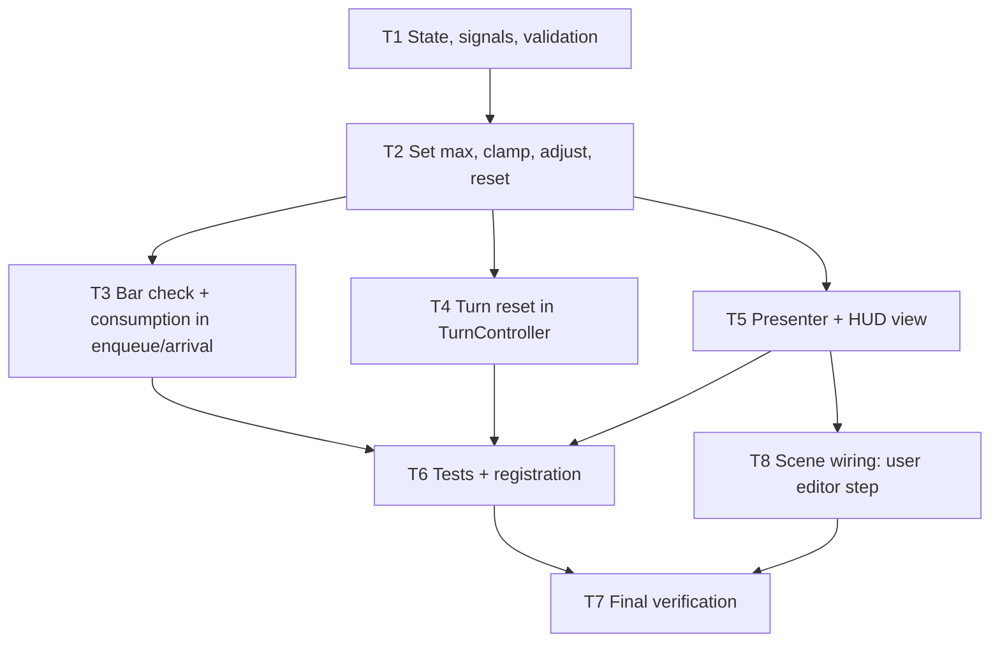

# Action Bar: Tasks

Do not run tests per task. Single final verification (T7).

## Dependency graph

Parallel after T2: T3, T4, T5.

## Tasks

| ID | Task | Files | Deps | Reqs |
|---|---|---|---|---|
| T1 | Add constant, private state, getters, two signals, `validate_max_actions`; init full on new game. | `farming_controller.gd` | none | R1,R2,R3 |
| T2 | Implement `try_set_max_actions`, `adjust_actions_remaining`, `reset_actions_remaining` with clamping and emit rules. | `farming_controller.gd` | T1 | R2-R4,R8 |
| T3 | Add bar check to `action_error`; consume at arrival commit; emit once post-commit; preserve state on failure. | `farming_controller.gd` | T2 | R5-R7,R9,R10 |
| T4 | Call reset after successful commit in `advance_turn`; failure paths untouched. | `turn_controller.gd` | T2 | R11,R12 |
| T5 | Connect signals via `_connect_once`; HUD view with `validate_configuration()`; show `last_error`. | `field_prototype_presenter.gd`, HUD view | T2 | R13 |
| T6 | Write `action_bar_test.gd` per design; register in runner. | `tests/logic/action_bar_test.gd`, `tools/run_tests.py` | T3,T4,T5 | R1-R12 |
| T7 | Final verification: full `run_tests.py` once; interactive HUD/turn-end check; report commands, outcomes, gaps. | none | T6,T8 | all |
| T8 | User: add HUD Label node and Inspector references in Godot Editor. | scene (user-authored) | T5 | R13 |

## Handoff checklist

- Each R-ID mapped to a passing test or flagged unverified.
- Remaining gaps and environment blockers reported.
