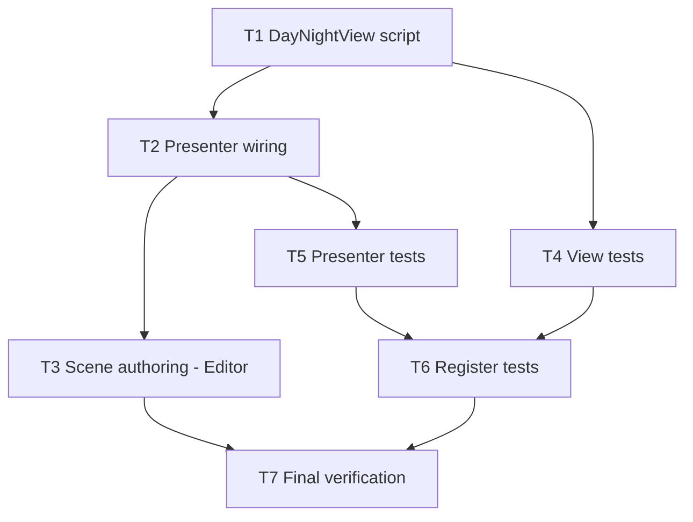

# Day and night cycle — tasks

Requirements: `requirements.md`. Design: `design.md`. Tests run once at T7 (`testing-guidelines.md`).

## Dependency graph

## Tasks

| ID | Task | Files | Depends | Reqs |
|---|---|---|---|---|
| T1 | Implement `DayNightView`: phase, tween, `night_finished`, `validate_configuration()`. | `src/presentation/world/day_night_view.gd` | none | R1, R4–R6 |
| T2 | Wire presenter: reference validation, `_connect_once` signals, night gating on Next Turn, deferred game-over overlay, `show_day()` on new game and load. | `src/presentation/world/field_prototype_presenter.gd` | T1 | R1, R3–R5, R8–R10 |
| T3 | Add the view node to the scene and wire exported references in the Godot Editor. Do not hand-edit `.tscn`. Do not rerun setup tools. | field scene (Editor) | T2 | R1, R4 |
| T4 | View tests: starts in day; transition reaches night then day; `night_finished` fires once; `turn_index` unchanged. | `tests/presentation/day_night_view_test.gd` | T1 | R1, R5, R6 |
| T5 | Presenter tests via the gameplay fixture and `push_input`: End Turn shows night; Next Turn disabled during night; rejected turn stays day; final turn shows night then overlay; load starts in day; same-seed parity; pending actions keep Next Turn disabled. | `tests/presentation/day_night_presenter_test.gd` | T2 | R2–R4, R8–R11 |
| T6 | Register both executables in `tools/run_tests.py`. | `tools/run_tests.py` | T4, T5 | all |
| T7 | Run the full suite once. Add an interactive visual check of the transition. Report commands, outcomes, and gaps. | none | T3, T6 | all |

## Notes

- T3 is a user-side Editor step if tooling is unavailable. T5 and T7 depend on it for scene-level checks.
- Tests must not save authored scenes. Redirect persistence to `user://` paths.
- Update task status and the day-night repo findings after T7.
