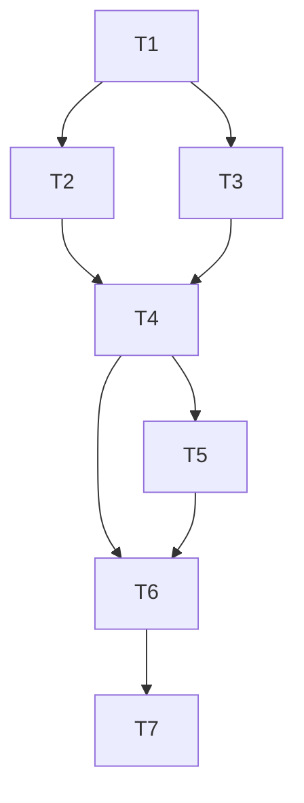

# Tasks — Farmer as Disease Vector

## Dependency graph

## Task table

| ID | Task | Depends on | Main files | Requirements |
|---|---|---|---|---|
| T1 | Confirm gameplay defaults, contact ordering, protection semantics, and action staging design | — | `requirements.md`, `design.md` | R1–R14 |
| T2 | Implement contamination state, validated configuration, clean reset, and scalar read API | T1 | `farming_controller.gd` | R1, R10, R13–R14 |
| T3 | Stage a transmission roll on the existing disease-activation stream | T1 | `disease_activation_controller.gd` | R2, R4–R5, R7–R8 |
| T4 | Stage and commit queued actions with farmer effects | T2, T3 | `farming_controller.gd`, `treatment_controller.gd` as needed | R1–R3, R6–R12 |
| T5 | Connect session dependencies and expire contamination on successful turns | T4 | `turn_controller.gd`, `field_prototype_presenter.gd` as needed | R1, R6, R9, R13–R14 |
| T6 | Add and register acceptance tests | T4, T5 | `tests/logic/farmer_disease_vector_test.gd`, `tools/run_tests.py` | R1–R14 |
| T7 | Run final verification and record results | T6 | Test logs and task status | R1–R14 |

## Task detail

- [x] **T1** Record approved chance and duration defaults. Confirm the proposed contact ordering and treatment behavior. Identify every state mutation and success signal in the queued action dispatch before changing it.
- [x] **T2** Store contamination in Logic. Check configuration ranges and expose only the scalar flag to presentation callers.
- [x] **T3** Use a detached activation state and stage exactly one draw for eligible attempts. Preserve automatic introduction history, including on successful transmission.
- [x] **T4** Keep validation and revision checks at arrival. Stage the normal action and vector effect together, reuse compatible disease initialization, and publish only after commit. Keep failure reporting and queue cleanup consistent with existing behavior. Cover duplicate arrival callbacks, crop-move delivery, already infected plots, and both forms of protection.
- [x] **T5** Reuse the existing session dependencies and arrival wiring. Apply expiry only when a manual turn commits and verify that restart resets contamination.
- [ ] **T6** Reuse the gameplay fixture and queued action driver. Check pickup, clean arrivals, forced hits and misses, same-seed replay, independent RNG streams, movement and duplicate arrivals, rejection, forced staged-validation failure, callback snapshots, detached reads, protection, and the expiry boundary. Assert that failure preserves the grid, contamination, RNG, counters, and clock.
- [ ] **T7** After implementation is complete, run the registered suite using `tools/run_tests.py` and a compatible Godot executable. Check the playable arrival path and report any acceptance criteria still unverified. Follow [testing-guidelines.md](../../../.agents/testing-guidelines.md) for failure follow-up.

## Implementation evidence

Implemented configurable defaults of 0.25 and three turns, final-target contact, a single carried disease, staged treatment and grid updates, activation RNG commits, and turn expiry. The registered farmer vector test passes. T6 remains open for exhaustive same-seed replay, observer callbacks, and forced validation-failure coverage. T7 remains open pending full-suite results and interactive arrival verification.

The full registered suite completed with exit code 1. Failures include atlas configuration errors, disease catalog assertions, the fence containment test dereferencing a rejected action, treatment serialization and parse errors, and presentation resource leaks. Interactive arrival verification remains outstanding.
