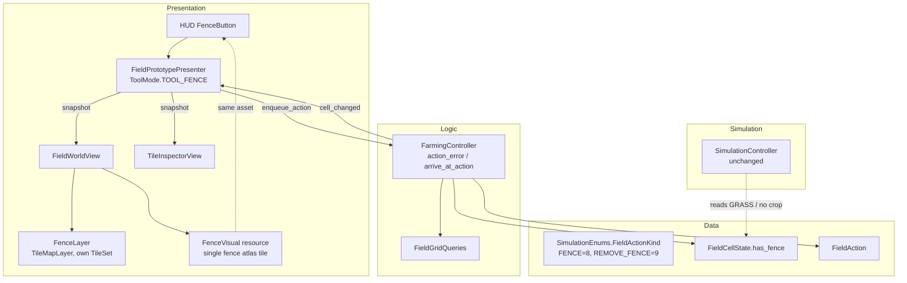
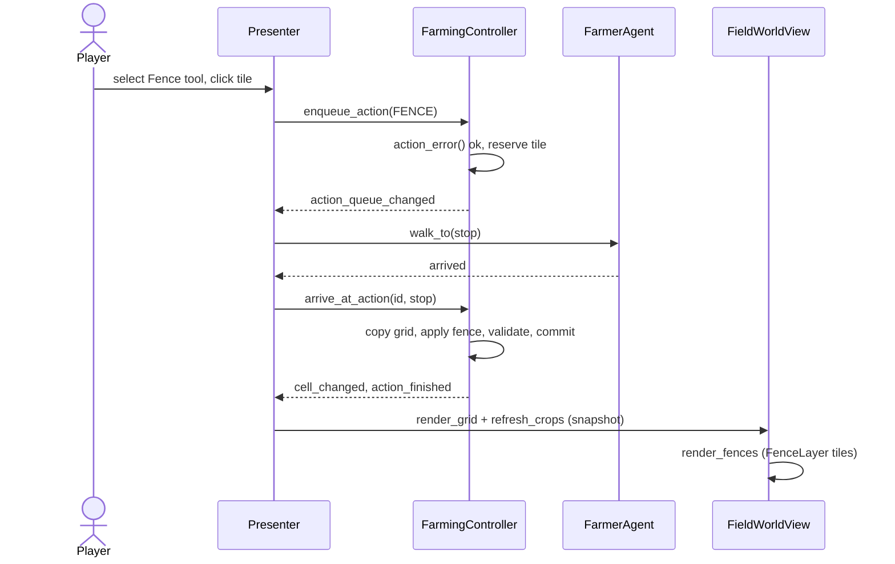

# Design Document

## Overview

A fence is a flag on `FieldCellState` set by a queued farmer action. Fencing a tile converts it to soil-less grass, clears any crop and disease on it, and blocks all farming actions. A second new action, `REMOVE_FENCE`, lets the Shovel destroy it.

Disease containment needs no change in Simulation. A fenced tile is GRASS with no crop, which `SimulationController` already excludes as a host and as pressure source. We add regression tests for this.

## Architecture



## Data Layer

### `src/data/enums/simulation_enums.gd`

Append, preserving existing numeric values:

```gdscript
enum FieldActionKind { REMOVE_CROP, DIG_GRASS, MAKE_PADDY, PLANT, MOVE_CROP, HARVEST, WATER_SOIL, FERTILIZE, FENCE, REMOVE_FENCE }
```

### `src/data/state/field_cell_state.gd`

```gdscript
## Tile-level fence. A fenced cell is empty grass with no soil.
var has_fence: bool = false
```

- `validate()` adds, when `has_fence`:
  - `terrain_type != GRASS` → "fenced cells must be grass."
  - `soil != null` → "fenced cells must not have soil."
  - `has_crop` → "fenced cells must be empty."
  - `has_active_disease` → "fenced cells must not have an active disease."
- `copy()` copies `has_fence`.
- `reset_crop_state()` is unchanged and does not touch `has_fence`.

`FieldAction` needs no new fields. `additions` and `crop_type` are ignored for fence actions.

## Logic Layer

### `FieldGridQueries.validate_terrain_assignments`

Add per cell: `if cell.has_fence and cell.terrain_type != GRASS` → "fenced cell must be on grass terrain." Existing rules already force grass to have null soil and no crop.

### `FarmingController`

**`action_error(action, check_reservations)`** adds branches:

| Kind | Rejected when | Message |
|---|---|---|
| `FENCE` | `cell.has_fence` | "This tile is already fenced." |
| `REMOVE_FENCE` | `not cell.has_fence` | "Choose a fence to remove." |
| `DIG_GRASS` | `cell.has_fence` | "Remove the fence before digging." |
| `MAKE_PADDY` | already rejected (needs DRY_SOIL) | existing |
| `WATER_SOIL` / `FERTILIZE` | `soil == null` (already) | existing |

Every branch also needs a valid in-field cell and, when `check_reservations`, no reservation. `FENCE` has no other restrictions, so it is valid on occupied, infected and grass tiles.

**`_planting_error`**: before the terrain checks, return "This tile is fenced." for fenced cells. This covers plant and move-crop destination.

**Commit helpers** use the existing copy–validate–commit pattern from `_convert_terrain`:

```gdscript
func _apply_fence(action: FieldAction) -> bool:
	var candidate: FieldGridState = _grid.copy()
	var cell: FieldCellState = candidate.get_cell(action.target)
	cell.has_crop = false
	cell.reset_crop_state()
	cell.terrain_type = SimulationEnums.TerrainType.GRASS
	cell.soil = null
	cell.has_fence = true
	var errors: PackedStringArray = FieldGridQueries.validate_terrain_assignments(candidate, crop_database, terrain_database)
	if not errors.is_empty():
		return _fail("\n".join(errors))
	_grid = candidate
	last_error = ""
	_emit_cell_changed(action.target)
	return true

func _remove_fence(action: FieldAction) -> bool:
	# same pattern; sets has_fence = false only
```

**`arrive_at_action`**: add `FENCE → _apply_fence`, `REMOVE_FENCE → _remove_fence` to the match. Stale-revision cancellation already applies, because `_emit_cell_changed` bumps `_revisions`.

No public non-queued API is needed, but `_apply_fence` is covered by tests through the queue.

`advance_simulated_turn` and `_stage_growth` need no change. Fenced cells have no crop and are skipped, and `validate_terrain_assignments` accepts them.

## Simulation Layer

No code change.

- `_pressure()` skips neighbors with `terrain_type == GRASS` or no crop.
- `validate_turn()` and `process_turn()` skip cells without crops.
- `DiseaseActivationController.is_eligible()` requires `has_crop`.

A regression test in `tests/simulation/` locks this behavior.

## Presentation Layer

### `FenceVisual` (`src/presentation/world/fence_visual.gd`)

Rendering identifiers only, in the style of `TerrainTileVisual`. It is the single reference to the fence asset. Logic and Data never see it.

```gdscript
@tool
class_name FenceVisual
extends Resource
@export var source_id: int = -1
@export var atlas_coords: Vector2i = Vector2i.ZERO
@export var alternative_tile: int = 0

func validate(tile_set: TileSet) -> PackedStringArray  # source exists, is an atlas, tile and alternative exist
func make_icon(tile_set: TileSet) -> Texture2D          # AtlasTexture cut from the same atlas region
```

The map layer and the HUD button both read this one resource, so the map tile and the button icon are the same asset.

### `FenceLayer` (`World/FenceLayer`, `TileMapLayer`)

- Own `TileSet` with one fence atlas source. It is never shared with the terrain or crop `TileSet`, so editing fence art cannot change terrain or crop definitions.
- Tile shape, layout, size and offset axis match the terrain `TileSet`. Transform follows `terrain_layer`.
- `y_sort_enabled = true`, z-index in the crop/actor tier, so fences sort with crops and the farmer.
- Collision and navigation disabled.
- The terrain layer keeps showing the grass tile underneath. The fence is drawn on top.

### `FieldWorldView`

- `@export var fence_layer: TileMapLayer` and `@export var fence_visual: FenceVisual`.
- `render_fences(snapshot)`:
  - Returns early when `fence_layer` or `fence_visual` is null.
  - Refuses to clear when `fence_layer` is the terrain, crop, grass or background layer.
  - Erases cells that are no longer fenced, then sets `fence_visual` tile on each fenced cell.
- `render_grid()` and `refresh_crops()` call `render_fences()`.
- `validate_fence_visual()` returns `fence_visual.validate(fence_layer.tile_set)` errors. It is separate from `validate_configuration()`, so fences stay optional.
- `_align_crop_grid()` is generalized to an `_align_layer(layer)` helper and applied to the fence layer.
- `get_fence_icon()` returns `fence_visual.make_icon(fence_layer.tile_set)`, or null when unconfigured.
- `_render_grass_overlay()` skips cells with `has_fence`. The RNG still consumes one value per coordinate, so other tufts do not move.

### `FieldPrototypePresenter`

- `ToolMode.TOOL_FENCE` appended to the enum.
- `@export var fence_button: Button` in the HUD group.
- `_ready()` adds `fence_button` to the toggle-mode list and sets `fence_button.icon = world_view.get_fence_icon()` when it is not null. `_connect_signals()` registers it with `world_view.register_ui_input_root` and connects `pressed` to `_on_fence_pressed`.
- `_set_controls_enabled()` and `_show_failure()` include `fence_button`.
- `_update_crop_buttons()` calls `fence_button.set_pressed_no_signal(_tool_mode == TOOL_FENCE)`.
- `_select_management_tool()` for `TOOL_FENCE` sets "Tool: Fence" and "Click or drag over tiles to fence them."
- `_make_action()`:
  - `TOOL_FENCE` → `FENCE`.
  - `TOOL_REMOVE` → `REMOVE_FENCE` if the cell is fenced, else `REMOVE_CROP` if it has a crop, else `DIG_GRASS`.
- `_refresh_tool_targets()` needs no change. It asks `action_error()` for eligibility.
- `_refresh_inspected_cell()` needs no change. Seed availability already requires `has_crop`.

### `TileInspectorView`

`display_cell()` appends " (fenced)" to the terrain text when `cell_state.has_fence`. No new nodes, so the bake bindings are unchanged.

### Scene wiring

- `tools/bake_ui_to_scene.gd`:
  - `NODE_TYPES`: `"HUD/FenceButton": &"Button"`.
  - `HUD_BINDINGS`: `&"fence_button": ^"HUD/FenceButton"`.
  - Bottom-right stack offsets `-344 / -296`.
  - Add to the camera-button script list, the toggle-mode list, and `_preview_text` ("Fence").
- `tools/setup_fence_tool.gd` (new `EditorScript`, idempotent): runs the baker, then:
  - Creates `World/FenceLayer` with its own `TileSet` copied from the terrain geometry settings, and adds one atlas source from `res://assets/art/tilesets/fence/fence.png`.
  - Creates and saves `res://src/presentation/world/fence_visual.tres` pointing at that source.
  - Sets `world.fence_layer` and `world.fence_visual`, sets z-order between `CropShadows` and `SelectionOverlay`, and saves with a UID check.
  - Skips anything that already exists, so reruns keep hand-edited fence art and transforms.
- The fence PNG is a prerequisite asset: one tile, sized to the terrain tile footprint.

## Fence Flow



## Error Handling

| Condition | Behavior |
|---|---|
| Target outside field | Reject, "Choose a tile inside the field." |
| Reserved target | Reject, "This plot already has a queued action." |
| Already fenced (fence) | Reject at enqueue |
| Plot changed during walk | Cancel at arrival, state unchanged |
| Validation failure at commit | `_fail()`, grid unchanged, no signal |
| `fence_layer` or `fence_visual` unassigned | Render without fences |
| `FenceVisual` points at a missing source or tile | `validate_fence_visual()` reports it; fences are not drawn |

## Correctness Properties

Written for `PropertyTestRunner` (≥100 iterations, tagged `# Feature: fence-treatment, Property N`).

1. **Fence postcondition.** For any valid tile and prior state, after a committed `FENCE` the cell has `has_fence`, terrain `GRASS`, soil null, no crop, no disease, zero compartments, and `validate()` is empty.
2. **Enqueue purity.** For any valid or invalid action, `enqueue_action` leaves the grid unchanged.
3. **Fenced tile rejects all farming.** For any fenced cell and any of plant, move-destination, bucket, dig, water, fertilize, harvest, remove-crop, fence: `action_error` is non-empty and the grid is unchanged.
4. **Fence/unfence round trip.** `FENCE` then `REMOVE_FENCE` gives a GRASS, soil-null, unfenced cell, and `DIG_GRASS` then succeeds.
5. **Containment.** For any grid with fenced cells and any infection, after `process_turn` fenced cells have all fractions zero and no disease, and their neighbors' results equal those of the same grid with those cells as ordinary grass.
6. **Locality.** A committed fence or fence removal changes only the target cell. `turn_index` is unchanged.
7. **Copy fidelity.** `cell.copy().has_fence == cell.has_fence`, and the copy validates identically.

## Testing Strategy

| File | Type | Covers |
|---|---|---|
| `tests/logic/fence_treatment_test.gd` | Logic | `fence_treatment.feature` scenarios, Requirements 1–6, 8, 10 |
| `tests/logic/fence_treatment_property_test.gd` | Property | Properties 1–4, 6, 7 |
| `tests/simulation/fence_containment_test.gd` | Simulation | Requirement 7, Property 5 |
| `tests/presentation/fence_presentation_test.gd` | Presentation | Requirement 9: fence layer tiles, shared asset for tile and icon, independent TileSet, tufts, inspector, HUD button, shovel drag |

All register in `tools/run_tests.py`. Existing tests, including the tile-inspector builder editor test, must still pass. They check `HUD_BINDINGS` generically, so adding `fence_button` is covered.

## Design Decisions

- **Flag on the cell, not a new terrain type.** `TerrainType` has plantability and visual-map coupling. A flag avoids changing `TerrainDatabase`, `TerrainTileVisualMap` and the scene's `terrain_bands`.
- **Terrain GRASS plus soil null.** This reuses the existing grass rules in Simulation and in `validate_terrain_assignments`.
- **Separate `REMOVE_FENCE`.** The Shovel picks the kind from the cell, as it already does for `REMOVE_CROP` and `DIG_GRASS`. Drag selection already locks to one kind.
- **Separate fence atlas and layer.** Fence art lives in its own `TileSet` on its own `TileMapLayer`, so it is decoupled from terrain and crop art.
- **One shared `FenceVisual`.** The map layer and the HUD button icon come from the same resource, so there is a single fence asset.
- **Art is a prerequisite.** No fence PNG exists in the project yet.
