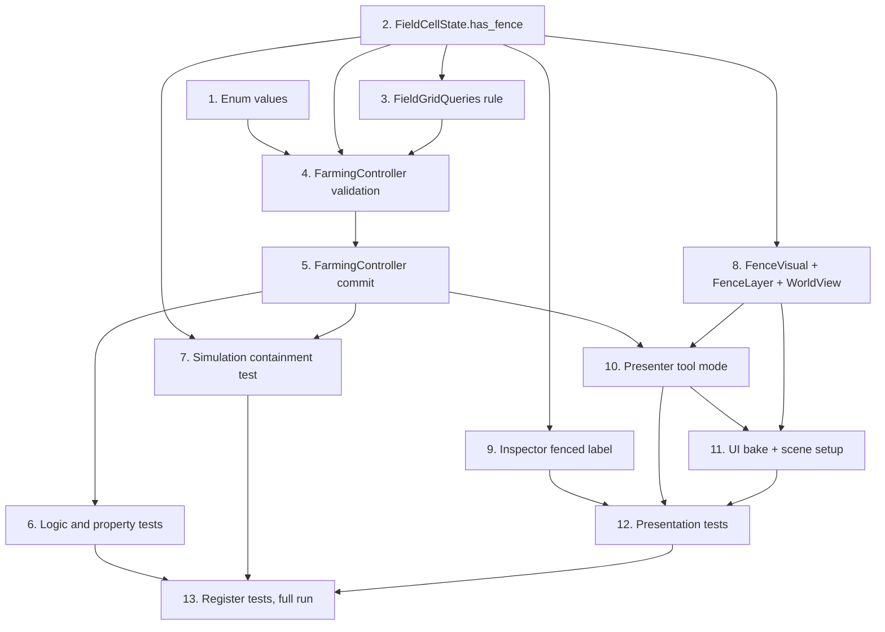

# Implementation Plan: Fence Treatment Method

## Task Dependency Graph

**Critical path:** 2 → 3 → 4 → 5 → 10 → 11 → 12 → 13

## Execution Waves

| Wave | Tasks | Runs in parallel |
|---|---|---|
| 1 | 1, 2 | yes |
| 2 | 3 | no |
| 3 | 4 | no |
| 4 | 5 | no |
| 5 | 6, 7, 8, 9 | yes |
| 6 | 10 | no |
| 7 | 11 | no |
| 8 | 12 | no |
| 9 | 13 | no |

## Tasks

- [x] 1. Add fence action kinds
  - Append `FENCE` and `REMOVE_FENCE` to `SimulationEnums.FieldActionKind` in `src/data/enums/simulation_enums.gd`
  - Keep existing values unchanged (`FENCE = 8`, `REMOVE_FENCE = 9`)
  - Depends on: none
  - _Requirements: 4.6_

- [x] 2. Add `has_fence` to `FieldCellState`
  - [ ] 2.1 Add `var has_fence: bool = false` with doc comment
    - Do not touch it in `reset_crop_state()`
    - _Requirements: 4.1, 4.5_
  - [ ] 2.2 Extend `validate()` with fenced-cell rules (grass terrain, null soil, no crop, no disease)
    - _Requirements: 4.2_
  - [ ] 2.3 Copy `has_fence` in `copy()`
    - _Requirements: 4.3_
  - Depends on: none
  - _Requirements: 4.1, 4.2, 4.3, 4.5_

- [x] 3. Add fence invariant to `FieldGridQueries.validate_terrain_assignments`
  - Report an error for a fenced cell on non-grass terrain
  - Depends on: 2
  - _Requirements: 4.4_

- [x] 4. Add fence validation to `FarmingController`
  - [ ] 4.1 Extend `action_error()` for `FENCE` and `REMOVE_FENCE`
    - `FENCE` rejected when already fenced
    - `REMOVE_FENCE` rejected when not fenced
    - _Requirements: 1.3, 1.4, 1.5, 1.6, 1.7, 6.3_
  - [ ] 4.2 Reject `DIG_GRASS` on fenced tiles
    - _Requirements: 5.1_
  - [ ] 4.3 Return "This tile is fenced." from `_planting_error()` for fenced cells
    - Covers plant and move-crop destination
    - _Requirements: 5.1_
  - [ ] 4.4 Confirm `MAKE_PADDY`, water, fertilize, harvest and remove-crop reject fenced cells through existing checks
    - Add explicit checks only where a message is wrong
    - _Requirements: 5.1, 5.2, 5.3, 5.4_
  - Depends on: 1, 2, 3
  - _Requirements: 1.3–1.7, 5.1–5.4, 6.3_

- [x] 5. Add fence commit logic to `FarmingController`
  - [ ] 5.1 Implement `_apply_fence()` on a copied grid, clear crop and disease via `reset_crop_state()`, set GRASS, null soil, `has_fence`, validate, commit, emit `cell_changed`
    - _Requirements: 2.1, 2.2, 3.1, 3.2, 3.4, 8.2, 8.3_
  - [ ] 5.2 Implement `_remove_fence()` with the same transaction pattern
    - _Requirements: 6.2, 6.6_
  - [ ] 5.3 Add `FENCE` and `REMOVE_FENCE` branches to `arrive_at_action()` match
    - Confirm `action_finished` success flag and no turn advance
    - Confirm stale-revision cancellation works
    - _Requirements: 2.3, 5.5, 8.1_
  - [ ] 5.4 Confirm fence does not touch harvest counts or `GameStateManager`
    - _Requirements: 3.3_
  - Depends on: 4
  - _Requirements: 2.1–2.3, 3.1–3.4, 5.5, 6.2, 6.6, 8.1–8.3_

- [x] 6. Write Logic tests
  - [ ] 6.1 `tests/logic/fence_treatment_test.gd`
    - Implement every scenario in `fence_treatment.feature` (empty, occupied, infected, rejections, queue, arrival, stale action, shovel, dig after removal, turn persistence, new game)
    - Print `FENCE_TREATMENT_PASS`
    - _Requirements: 1–6, 8, 10_
  - [ ] 6.2 `tests/logic/fence_treatment_property_test.gd` using `PropertyTestRunner`
    - [ ]* 6.2.1 Property 1: fence postcondition
    - [ ]* 6.2.2 Property 2: enqueue purity
    - [ ]* 6.2.3 Property 3: fenced tile rejects all farming
    - [ ]* 6.2.4 Property 4: fence/unfence round trip
    - [ ]* 6.2.5 Property 6: locality and no time advance
    - [ ]* 6.2.6 Property 7: copy fidelity
    - _Requirements: 2, 3, 4, 5, 6, 8_
  - Depends on: 5
  - _Requirements: 1–6, 8, 10_

- [x] 7. Write Simulation containment test
  - `tests/simulation/fence_containment_test.gd`
  - Fenced cell is not a host and gives no pressure, for SIR, SEIR and CA
  - Fencing an infected crop clears its disease; `validate_turn` passes
  - `DiseaseActivationController` never selects a fenced cell
  - [ ]* Property 5: containment equivalence with ordinary grass
  - No production code change expected in `src/simulation/`
  - Depends on: 2, 5
  - _Requirements: 7.1–7.6_

- [x] 8. Add fence rendering (separate atlas, shared asset)
  - [ ] 8.1 Supply the fence PNG at `res://assets/art/tilesets/fence/fence.png`
    - One tile, sized to the terrain tile footprint
    - Manual art step
    - _Requirements: 9.1_
  - [ ] 8.2 Create `src/presentation/world/fence_visual.gd` (`FenceVisual`: `source_id`, `atlas_coords`, `alternative_tile`, `validate(tile_set)`, `make_icon(tile_set)`)
    - _Requirements: 9.1, 9.5_
  - [ ] 8.3 Add `fence_layer` and `fence_visual` exports to `FieldWorldView`
    - `render_fences(snapshot)` sets and erases fence tiles, with a guard against clearing other layers
    - Call it from `render_grid()` and `refresh_crops()`
    - Generalize `_align_crop_grid()` into `_align_layer()` and apply it to the fence layer
    - Add `validate_fence_visual()` and `get_fence_icon()`
    - Null-safe
    - _Requirements: 9.1, 9.2, 9.8, 10.2_
  - [ ] 8.4 Skip grass tufts on fenced cells in `_render_grass_overlay()`, keeping one RNG draw per coordinate
    - _Requirements: 9.3_
  - Depends on: 2
  - _Requirements: 9.1, 9.2, 9.3, 9.7, 9.8_

- [x] 9. Show fenced status in `TileInspectorView`
  - Append " (fenced)" to the terrain text when `has_fence`
  - No new nodes or bindings
  - Depends on: 2
  - _Requirements: 9.4_

- [x] 10. Wire the Fence tool in `FieldPrototypePresenter`
  - [ ] 10.1 Add `TOOL_FENCE` to `ToolMode` and `@export var fence_button: Button`
    - _Requirements: 1.1, 9.5_
  - [ ] 10.2 Update `_ready()`, `_connect_signals()`, `_set_controls_enabled()`, `_show_failure()`, `_update_crop_buttons()` for `fence_button`
    - Set `fence_button.icon` from `world_view.get_fence_icon()` when not null
    - Null-safe
    - _Requirements: 9.5, 9.6_
  - [ ] 10.3 Add `_on_fence_pressed()` and `TOOL_FENCE` messages in `_select_management_tool()`
    - _Requirements: 1.1_
  - [ ] 10.4 Update `_make_action()`: `TOOL_FENCE` → `FENCE`; `TOOL_REMOVE` → `REMOVE_FENCE` / `REMOVE_CROP` / `DIG_GRASS` by cell
    - _Requirements: 1.2, 6.1, 6.5_
  - [ ] 10.5 Confirm eligibility highlighting and drag-lock work through `action_error()`
    - _Requirements: 1.1, 6.5_
  - Depends on: 5, 8
  - _Requirements: 1.1, 1.2, 6.1, 6.5, 9.5, 9.6_

- [x] 11. Bake UI and wire the scene
  - [ ] 11.1 Update `tools/bake_ui_to_scene.gd`: `NODE_TYPES`, `HUD_BINDINGS`, button offsets (-344 / -296), script list, toggle list, `_preview_text`
    - _Requirements: 9.5, 11.2_
  - [ ] 11.2 Create `tools/setup_fence_tool.gd` (idempotent EditorScript)
    - Run baker
    - Add `World/FenceLayer` with its own `TileSet` (terrain geometry settings, one atlas source from the fence PNG)
    - Save `fence_visual.tres` and set `world.fence_layer` and `world.fence_visual`
    - Z-order between `CropShadows` and `SelectionOverlay`; save and verify scene UID
    - _Requirements: 9.1, 11.2_
  - [ ] 11.3 Run the setup script in the editor and save `field_prototype.tscn`
    - Manual step
    - _Requirements: 11.2_
  - Depends on: 8, 10
  - _Requirements: 9.1, 9.5, 11.2_

- [x] 12. Write Presentation tests
  - `tests/presentation/fence_presentation_test.gd`
  - `FenceLayer` has tiles on fenced cells and erases them when the fence is removed
  - Fence layer `TileSet` is independent of the terrain and crop `TileSet`
  - HUD button icon and map tile come from the same atlas region
  - `validate_fence_visual()` reports bad source or tile
  - No tufts on fenced cells; unassigned layer or visual is safe
  - Inspector shows "Grass (fenced)"
  - Fence button toggles tool and is disabled outside PLAYING
  - Shovel drag from a fenced tile selects only fenced tiles
  - Play Again clears fences
  - Print `FENCE_PRESENTATION_PASS`
  - Depends on: 9, 10, 11
  - _Requirements: 6.5, 9.1–9.8, 10.2_

- [x] 13. Register tests and run the full suite
  - Add the four new tests to `tools/run_tests.py`
  - Run `python tools/run_tests.py --godot <path>`
  - Fix regressions in existing tests, especially `tile_inspector_builder_editor_test.gd`, `field_scene_integration.gd`, `queued_field_actions_test.gd`
  - Depends on: 6, 7, 12
  - _Requirements: 11.3, 11.4_

## Notes

- Tasks marked `*` are optional property tests. Core tests still cover each requirement.
- Do not edit `field_prototype.tscn` by hand. Use `tools/setup_fence_tool.gd`.
- Task 8.1 (fence art) must exist before task 11.3 runs.
- Dependencies listed under each task are the source for the graph above.
