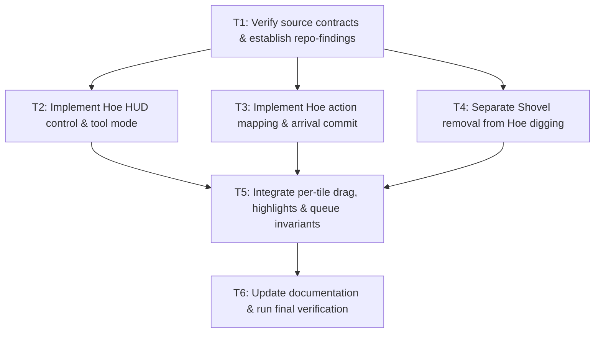

# Tasks — Hoe and Shovel Tools

## Task Graph

## Task List

- [x] **T1: Source verification & setup**
  - Verify `ToolMode`, `FieldCellState`, `FarmingController`, and UI setup scripts.
  - Create `repo-findings.md` to log current code facts and confirmed signatures.

- [x] **T2: Add Hoe HUD control and tool mode**
  - Append `TOOL_HOE` to `ToolMode` enum.
  - Add Hoe button in `tools/bake_ui_to_scene.gd` and run editor setup (`setup_field_tools.gd`).
  - Wire toggle state (`INSPECT` switch), mode labels (`Tool: Hoe`), and control disabling outside `PLAYING`.

- [x] **T3: Implement Hoe eligibility & arrival-time commit**
  - Define Hoe target predicate (empty grass, no crop, no fence). Map direct click to `DIG_GRASS`.
  - Report `Hoe requires empty grass.` for invalid in-bounds direct clicks.
  - On arrival: convert terrain to `DRY_SOIL`, set soil copy from `initial_soil`, and trigger visual cleanup.

- [x] **T4: Separate Shovel removal from Hoe digging**
  - Restrict `TOOL_REMOVE` (`Shovel`) to `REMOVE_CROP` and `REMOVE_FENCE`. Remove `DIG_GRASS` branches from Shovel.
  - Direct clicks on empty/invalid tiles report `Choose a crop to remove.`
  - On arrival: reset crop fields (growth/vitality/disease) while preserving terrain and soil. Support fence removal commit.

- [x] **T5: Integrate drag selection, highlights & queue invariants**
  - Update highlight predicates for Hoe (empty grass) and Shovel (crops & fences).
  - Implement independent per-tile drag eligibility evaluation. Skip ineligible tiles. Clear drag on tool switch.
  - Ensure standard plot reservation (`This plot already has a queued action.`), turn-blocking, and stale action cancellation remain intact.

- [x] **T6: Documentation & final verification pass**
  - Update `docs/QUEUED_FIELD_ACTIONS.md` to document the Hoe/Shovel split and drag rules.
  - Execute full acceptance test pass matching `separate-hoe-and-shovel.feature`.