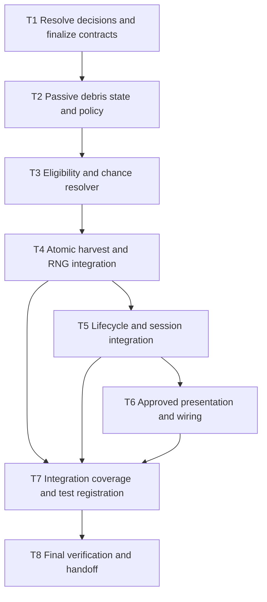

# Tasks: Infected Debris Chance After Harvest

Status: Core implementation and automated checks added. Final verification has engine diagnostics; manual visual/Android checks remain outstanding. See [requirements.md](requirements.md) and [design.md](design.md).

## Completed specification work

- [x] Create draft Gherkin scenarios for chance resolution and queued harvest integration.
- [x] Create requirements with open decisions D1–D5 and scenario traceability.
- [x] Create the proposed state, RNG, and atomic harvest design.
- [x] Create implementation tasks and their dependency graph.
- [x] Check specification links, Markdown structure, and graph ordering.

The previous AGENTS.md instructions were withdrawn by the user. This plan does not impose their separate cross-layer approval requirement. D1–D5 are now resolved in requirements.md following the user request to resolve problems and implement the feature.

## Dependency graph

The graph is an execution dependency graph, not an instruction to spawn agents. T6 is conditional: if presentation is explicitly deferred at T1, record the remaining visibility gap and satisfy the T6 gate by documenting that deferral. Do not report a fully visible feature as complete in that case.

| Task | Depends on | Requirement coverage |
|---|---|---|
| T1 | — | D1–D5; acceptance additions for R4–R6 |
| T2 | T1 | R5, R6 |
| T3 | T2 | R1, R4, R6 |
| T4 | T3 | R1–R5 |
| T5 | T4 | R5, approved D4 |
| T6 | T5 | Approved D5 |
| T7 | T4, T5, T6 | R1–R6 and approved extensions |
| T8 | T7 | Final evidence for all accepted criteria |

## Implementation checklist

- [x] **T1 — Resolve gameplay decisions and finalize the implementation contract**
  - [x] Record D1 eligibility across all supported disease representations.
  - [x] Record D2 probability scope/default and seed; D3 metadata; D4 lifecycle/interactions; D5 visual scope or explicit deferral.
  - [x] Confirm the proposed one-draw convention at probability endpoints and configuration validation behavior.
  - [x] Extend Gherkin for state copying, rollback, RNG isolation, initialization, invalid configuration, and selected lifecycle/presentation rules.
  - [x] Reconcile requirements/design and Gherkin with those decisions before dependent coding. Proceed when implementation is requested without adding a separate cross-layer approval step.

- [x] **T2 — Add passive state and policy, with focused tests**
  - [x] Add the approved debris fields to `FieldCellState`; update detached copying and validation.
  - [x] Define the policy resource with approved defaults and finite [0, 1] probability validation.
  - [x] Write state-copy, metadata-invariant, and invalid-policy tests; do not execute them yet.

- [x] **T3 — Implement eligibility and chance resolution, with focused tests**
  - [x] Add a resolver that uses pre-harvest state, the approved policy, and a supplied draw without mutating the live field.
  - [x] Cover exact probability boundaries and every approved eligibility class.
  - [x] Specify and test the sampling adapter's [0, 1) range and approved draw-count convention.

- [x] **T4 — Integrate an atomic harvest transaction, with focused tests**
  - [x] Add a separate seeded debris RNG owned by `FarmingController`.
  - [x] Stage crop removal, debris, and RNG state; validate before committing and notifying observers.
  - [x] Preserve existing queue validation, stale/duplicate arrival handling, receipt quality, scoring, and turn behavior.
  - [x] Cover victory-threshold scoring, no turn advancement, empty/immature/out-of-field/reserved targets, arrivals, direct harvesting, stale/duplicate arrivals, and post-draw rollback.

- [x] **T5 — Integrate lifecycle and initialization, with focused tests**
  - [x] Audit `reset_crop_state`, cell/grid copies, turn staging, planting, movement, removal, fencing, and conversion against D4.
  - [x] Apply only approved lifecycle changes; add regression coverage for affected operations.
  - [x] Initialize fresh fields without debris and reset the dedicated seed on successful initialization only.
  - [x] Cover failed initialization and deterministic replay without perturbing other random streams.

- [x] **T6 — Implement approved presentation and resource wiring**
  - [x] Apply D5's indication through existing views/presenters consuming detached committed state, or record the approved deferral.
  - [x] If required, wire policy/assets through the Godot Editor or established tools while preserving authored references.
  - [x] Write relevant presentation checks and an interactive verification checklist for the approved scope.

- [x] **T7 — Complete acceptance coverage and register tests**
  - [x] Map Gherkin and R1–R6 to the executable coverage and interactive checklist below.
  - [x] Register new test executables in `tools/run_tests.py`; reuse current fixtures and conventions.
  - [x] Review rollback, RNG isolation, duplicate notifications, and unchanged neighboring tiles across the full integration.
  - [x] Run the registered suite after adding the core implementation and checks; keep incomplete coverage explicit.

- [ ] **T8 — Perform the single final verification phase and handoff**
  - [x] Import project/assets in a compatible Godot editor, then run `python tools/run_tests.py --godot '<installed Godot executable>'` once.
  - [ ] Require exit zero, `_PASS` markers, and no error, warning, or failure diagnostics; fix failures and rerun affected checks as needed.
  - [ ] Complete acceptance-focused interactive checks if visuals/input changed; document unavailable Android verification.
  - [ ] Review spec/Gherkin traceability and report commands, results, environmental blockers, and remaining gaps.
  - [ ] Mark only verified tasks complete and update owning documentation if implementation changes established facts.

## Verification evidence and remaining checks

The registered suite was invoked with Python 3.15.2 and Godot 4.7.2. The debris executable reaches `INFECTED_DEBRIS_PASS`, but scene-loading TileSet atlas errors prevent a clean pass. Full output is in `.godot/debris-suite-results.txt`; feature diagnostics are in `.godot/infected_debris_test.log`.

Coverage in `tests/logic/infected_debris_test.gd`: thresholds, policy validation, categorical/continuous eligibility, arrival timing, duplicate reservation/arrival, stale cancellation, quality and score, copies, inspector text, planting/fencing/conversion/movement/removal lifecycle, replay, failed initialization, and post-draw rollback.

The follow-up debris run also covers victory-threshold behavior, invalid targets, and unrelated global-RNG perturbation; it reaches the pass marker with no assertion failures but retains atlas errors. Remaining verification: clean engine diagnostics and manual inspector layout on PC and Android. Interactive checklist: harvest an eligible crop with chance 1, inspect the resulting empty tile, confirm the label is readable, plant and inspect again to confirm it clears. No Android or visual-layout pass is claimed.

Final suite result: **11 passed, 19 failed** (30 registered executables). Failures include TileSet atlas errors, disease catalog expectations, saved scene UID/animation expectations, and a terrain-preview runtime timeout. No claim is made that all failures predate this change without a baseline run. Authored assets were not modified. Expanded debris follow-up output: `.godot/debris-followup-results.txt`.

| Acceptance area | Evidence |
|---|---|
| R1 chance and eligibility | Boundary table and categorical/continuous eligibility assertions |
| R2 queued/rejected/stale/duplicate actions | Manual arrival and invalid-target assertions |
| R3 crop result and scoring | Quality, cleared-cell validation, score, victory threshold, turn counter |
| R4 repeatability | Two 20-harvest replays with unrelated RNG activity |
| R5 copies, atomicity, initialization | Detached snapshot, injected post-draw failure, failed initialization |
| R6 configuration | Out-of-range, infinity, NaN and rejected harvest/initialization |
| D4 lifecycle | Plant, fence, conversion, movement, removal, growth-copy assertions |
| D5 indication | Inspector label assertion; manual layout remains outstanding |
