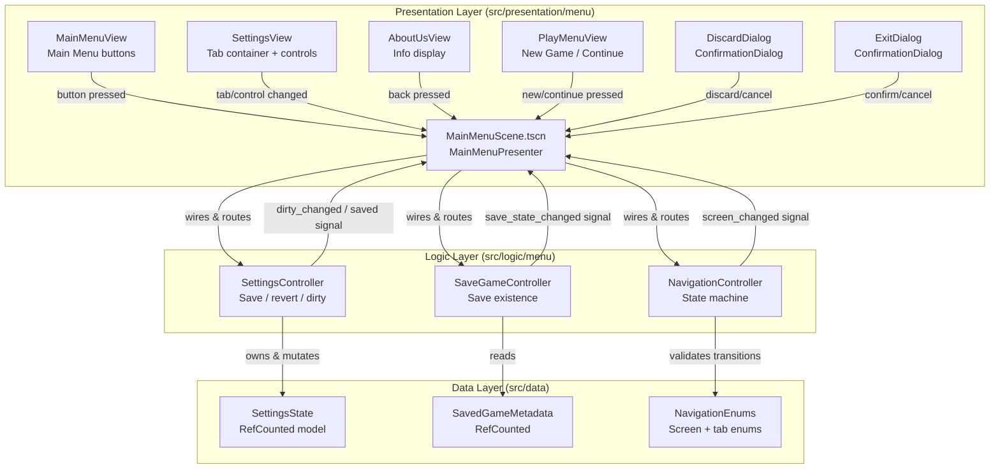
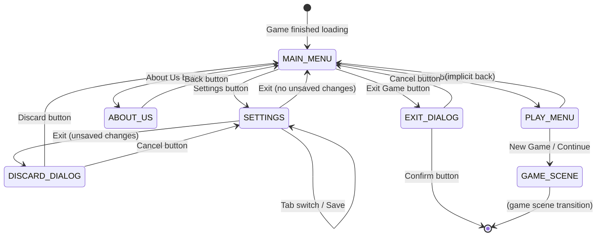

# Design Document

## Introduction

This design document defines the technical architecture for the Scene Management and Navigation feature, covering the Game's Main Menu and all associated sub-panels: Settings (Sound, Graphics, Difficulty tabs), About Us, Play Menu, settings persistence, unsaved-change handling, game initialization, and game exit confirmation. The design follows the project's existing four-layer architecture (Data, Simulation, Logic, Presentation) and Godot 4.7.2 typed-GDScript conventions, mapping menu behavior to the same ownership contracts already used by the farming prototype.

All seven requirements from `requirements.md` are addressed, with every acceptance criterion traced to a component, interface, and data model below.

## Overview

The Main Menu is the entry point a player sees after the Game loads. From it, the player navigates to four destinations: Settings, About Us, Play, and Exit Game. The Settings panel itself contains three tabs (Sound, Graphics, Difficulty) and manages a save/discard lifecycle for unsaved changes. The Play menu offers New Game and Continue, with Continue gated by the existence of a saved game. Exiting the Game requires confirmation through a dialog.

The design separates navigation flow (a state machine), settings state management (a data model with dirty tracking and persistence), and presentation (Godot Control-based UI scenes). This separation keeps presentation thin—each UI panel only forwards button presses to logic controllers and renders state returned by them—matching the existing pattern where `FieldPrototypePresenter` routes intents to `FarmingController` and renders detached snapshots.

### Design Decisions and Rationale

| Decision | Rationale |
|---|---|
| Single-scene panel layering over scene-switching | Panels are stacked Control nodes toggled by visibility within one `MainMenuScene`. This avoids load delays for lightweight menus, keeps all references in one composition root, and matches the existing project's single-scene `field_prototype.tscn` approach. The field prototype loads as a separate scene only when a game starts. |
| Navigation state machine in Logic layer | Centralizes valid transitions and prevents illegal navigation (e.g., reaching Settings discard dialog from the About Us panel). The state machine is pure logic with no UI dependencies, making it independently testable. |
| Settings as a RefCounted data model with dirty tracking | Keeps settings logic out of UI scripts (per project convention: "Keep calculations out of UI scripts"). The model tracks working vs. saved values, enabling revert and save-confirm semantics cleanly. |
| ConfigFile for settings persistence | Godot's built-in `ConfigFile` writes to `user://` paths, which are platform-portable and require no external dependencies. This is the idiomatic Godot approach for user settings. |
| Signal-based communication | Matches the existing project's pattern (e.g., `farming_controller.field_initialized`, `turn_controller.turn_completed`). UI listens to controller signals and refreshes accordingly. |
| Separate Logic controllers from Presentation presenters | `NavigationController` and `SettingsController` are `Node`-based logic controllers; `MainMenuPresenter` is the composition root that wires them to UI controls. This preserves the existing ownership contract where logic owns state and presentation renders snapshots. |

## Architecture

The feature fits into the existing four-layer architecture as follows:



### Navigation Flow



### Scene Loading Strategy

The `MainMenuScene` is the primary entry scene for the project (replacing `field_prototype.tscn` as the `run/main_scene` in `project.godot`). When the player starts or continues a game, the scene transitions to the game scene (`field_prototype.tscn` or a dedicated game scene) via `get_tree().change_scene_to_file()`. Returning to the Main Menu from the game is a future concern outside this feature's scope; the current requirements only define forward navigation from the menu into the game.

## Components and Interfaces

### Logic Layer Components

#### NavigationController (`src/logic/menu/navigation_controller.gd`)

A `Node`-based controller that owns the current screen state and validates transitions. It has no UI references—transitions are requested by name and validated against the state machine.

```gdscript
class_name NavigationController
extends Node

signal screen_changed(screen: NavigationEnums.Screen)
signal unsaved_exit_requested()

var current_screen: NavigationEnums.Screen = NavigationEnums.Screen.MAIN_MENU
var _has_unsaved_settings: bool = false
```

Key methods:
- `request_transition(target: NavigationEnums.Screen) -> bool` — Validates the transition from `current_screen` to `target`. If the transition is from `SETTINGS` to `MAIN_MENU` and there are unsaved changes, it emits `unsaved_exit_requested` and returns `false` (the actual transition happens after the discard dialog resolves). Returns `true` if the transition was applied.
- `set_unsaved_settings(has_unsaved: bool) -> void` — Called by `SettingsController` to inform navigation that unsaved changes exist (or have been cleared).
- `confirm_discard() -> void` — Called when the player confirms discarding; transitions to `MAIN_MENU`.
- `cancel_discard() -> void` — Called when the player cancels; returns to `SETTINGS`.

The controller emits `screen_changed` after every successful transition. `MainMenuPresenter` listens and updates panel visibility.

#### SettingsController (`src/logic/menu/settings_controller.gd`)

A `Node`-based controller that owns a `SettingsState` instance and manages save/revert lifecycle and persistence.

```gdscript
class_name SettingsController
extends Node

signal dirty_changed(is_dirty: bool)
signal saved()
signal load_failed(reason: String)

var state: SettingsState
var _saved_state: SettingsState
var _config_path: String = "user://settings.cfg"
```

Key methods:
- `load_settings() -> bool` — Reads `user://settings.cfg` via `ConfigFile`. If the file does not exist, loads defaults. Populates `state` and `_saved_state` (both equal). Emits `load_failed` on parse errors.
- `set_value(category: NavigationEnums.SettingsTab, key: String, value: Variant) -> void` — Updates a setting in `state`. Compares against `_saved_state`; if different, emits `dirty_changed(true)`. If reverting to the saved value, emits `dirty_changed(false)` if no other differences remain.
- `save() -> bool` — Serializes `state` to `ConfigFile`, writes to disk, copies `state` into `_saved_state`, emits `saved` then `dirty_changed(false)`. Returns `false` on write failure (with `last_error` set).
- `revert() -> void` — Copies `_saved_state` back into `state`, emits `dirty_changed(false)`.
- `is_dirty() -> bool` — Returns whether `state` differs from `_saved_state`.
- `get_value(category: NavigationEnums.SettingsTab, key: String) -> Variant` — Returns the current (working) value.

#### SaveGameController (`src/logic/menu/save_game_controller.gd`)

A `Node`-based controller that checks for the existence of a saved game and manages save metadata.

```gdscript
class_name SaveGameController
extends Node

signal save_state_changed(has_save: bool)

var _save_path: String = "user://savegame.dat"
```

Key methods:
- `has_saved_game() -> bool` — Returns `FileAccess.file_exists(_save_path)`.
- `refresh() -> void` — Re-checks existence and emits `save_state_changed` if the result changed since the last check. Called when the Play Menu opens and after a new game starts.
- `get_metadata() -> SavedGameMetadata` — Reads and parses save metadata header. Returns `null` if no save exists or parsing fails.

### Presentation Layer Components

#### MainMenuPresenter (`src/presentation/menu/main_menu_presenter.gd`)

The composition root that wires UI controls to logic controllers, following the same pattern as `FieldPrototypePresenter`. All references are assigned via `@export` in the Inspector.

```gdscript
class_name MainMenuPresenter
extends Node

@export var navigation_controller: NavigationController
@export var settings_controller: SettingsController
@export var save_game_controller: SaveGameController

@export var main_menu_view: MainMenuView
@export var settings_view: SettingsView
@export var about_us_view: AboutUsView
@export var play_menu_view: PlayMenuView
@export var discard_dialog: ConfirmationDialog
@export var exit_dialog: ConfirmationDialog
@export var game_scene: PackedScene
```

The presenter connects all button signals and controller signals in `_ready()`, routes button presses to the appropriate controller method, and updates panel visibility in response to `screen_changed`. It is responsible for:
- Enabling/disabling the Continue button based on `save_game_controller.has_saved_game()`.
- Showing the discard dialog when `NavigationController.unsaved_exit_requested` fires.
- Showing the exit dialog when the Exit Game button is pressed.
- Triggering the game scene transition on New Game / Continue.

#### MainMenuView (`src/presentation/menu/main_menu_view.gd`)

A `Control` script that exposes signals for the four main menu buttons: `settings_pressed`, `about_us_pressed`, `play_pressed`, `exit_pressed`. It also owns the button nodes (Settings, About Us, Play, Exit Game) so they are visible after the Game loads.

#### SettingsView (`src/presentation/menu/settings_view.gd`)

A `Control` script wrapping a `TabContainer` with three tabs. It exposes signals: `sound_tab_selected`, `graphics_tab_selected`, `difficulty_tab_selected`, `save_pressed`, `exit_pressed`, and `setting_changed(tab, key, value)`. It hosts the actual control widgets (sliders, option buttons) for each tab.

#### AboutUsView (`src/presentation/menu/about_us_view.gd`)

A `Control` script that displays static text about the Game and its developers. Exposes `back_pressed`.

#### PlayMenuView (`src/presentation/menu/play_menu_view.gd`)

A `Control` script that exposes `new_game_pressed` and `continue_pressed` signals. It holds references to the New Game and Continue buttons; the Continue button's `disabled` property is set by the presenter based on `SaveGameController`.

#### Dialog Handling

Both the Discard Confirmation Dialog and Exit Confirmation Dialog use Godot's built-in `ConfirmationDialog` node. The presenter connects to their `confirmed` and `canceled` signals:
- **Discard dialog**: `confirmed` → `SettingsController.revert()` + `NavigationController.confirm_discard()`; `canceled` → `NavigationController.cancel_discard()`.
- **Exit dialog**: `confirmed` → `get_tree().quit()`; `canceled` → dismiss dialog (stays on Main Menu).

## Data Models

### NavigationEnums (`src/data/enums/navigation_enums.gd`)

A `RefCounted` class holding shared enum identifiers, following the pattern of `simulation_enums.gd`.

```gdscript
class_name NavigationEnums
extends RefCounted

enum Screen {
    MAIN_MENU = 0,
    SETTINGS = 1,
    ABOUT_US = 2,
    PLAY_MENU = 3,
    DISCARD_DIALOG = 4,
    EXIT_DIALOG = 5,
    GAME_SCENE = 6,
}

enum SettingsTab {
    SOUND = 0,
    GRAPHICS = 1,
    DIFFICULTY = 2,
}

enum GraphicsQuality {
    LOW = 0,
    MEDIUM = 1,
    HIGH = 2,
}

enum Difficulty {
    EASY = 0,
    NORMAL = 1,
    HARD = 2,
}
```

### SettingsState (`src/data/state/settings_state.gd`)

A `RefCounted` model holding all settings values organized by category. It tracks working (potentially unsaved) values and provides `copy()` and `validate()` methods consistent with existing data classes.

```gdscript
class_name SettingsState
extends RefCounted

# Sound tab
var master_volume: float = 1.0           # 0.0–1.0
var music_volume: float = 0.8
var sfx_volume: float = 0.8

# Graphics tab
var graphics_quality: NavigationEnums.GraphicsQuality = NavigationEnums.GraphicsQuality.MEDIUM
var fullscreen: bool = false
var vsync: bool = true

# Difficulty tab
var difficulty: NavigationEnums.Difficulty = NavigationEnums.Difficulty.NORMAL
```

Key methods:
- `copy() -> SettingsState` — Deep-copies all settings values.
- `equals(other: SettingsState) -> bool` — Compares all fields for equality. Used by `SettingsController` to determine dirty state.
- `validate() -> PackedStringArray` — Reports invalid values (e.g., volumes out of [0.0, 1.0], invalid enum values) without mutating.

### SavedGameMetadata (`src/data/state/saved_game_metadata.gd`)

A `RefCounted` model for save game metadata, used by `SaveGameController`.

```gdscript
class_name SavedGameMetadata
extends RefCounted

var exists: bool = false
var timestamp: int = 0          # Unix epoch seconds
var turn_index: int = 0
var display_name: String = ""
```

### Settings Persistence Format

Settings are persisted via Godot's `ConfigFile` to `user://settings.cfg`:

```ini
[sound]
master_volume=1.0
music_volume=0.8
sfx_volume=0.8

[graphics]
graphics_quality=1
fullscreen=false
vsync=true

[difficulty]
difficulty=1
```

Enum values are stored as integers for forward-compatibility, matching the numeric-value preservation convention noted in `simulation_enums.gd`.

### State Ownership and Snapshot Contract

Following the existing ownership contract:
- `SettingsController` owns `SettingsState` (the working copy) and `_saved_state` (the last-persisted copy). Presentation never mutates these directly; it calls `set_value` on the controller.
- `NavigationController` owns `current_screen`. Presentation reads it only via the `screen_changed` signal.
- `SaveGameController` owns save existence state. Presentation reads it via `has_saved_game()` and the `save_state_changed` signal.

## Correctness Properties

*A property is a characteristic or behavior that should hold true across all valid executions of a system—essentially, a formal statement about what the system should do. Properties serve as the bridge between human-readable specifications and machine-verifiable correctness guarantees.*

### Property 1: Settings save clears dirty state

*For any* `SettingsState` with one or more field values differing from the saved state, when `SettingsController.save()` succeeds, the controller's `is_dirty()` SHALL return `false` and the working state SHALL equal the saved state.

**Validates: Requirements 3.1, 3.4**

### Property 2: Settings revert restores saved state

*For any* `SettingsState` with one or more unsaved modifications, when `SettingsController.revert()` is called, the working state SHALL become equal to the last saved state and `is_dirty()` SHALL return `false`.

**Validates: Requirements 4.1**

### Property 3: Settings dirty tracking reflects value differences

*For any* `SettingsState` and any sequence of `set_value` calls, `is_dirty()` SHALL return `true` if and only if the working state differs from the saved state in at least one field.

**Validates: Requirements 3.1, 3.2, 3.3**

### Property 4: Settings serialization round trip

*For any* valid `SettingsState`, serializing it to a `ConfigFile` and deserializing it back SHALL produce a `SettingsState` that equals the original.

**Validates: Requirements 3.1**

### Property 5: Navigation transitions are valid

*For any* current screen and any requested target, `NavigationController.request_transition` SHALL apply the transition if and only if it is a valid transition in the state machine, and `current_screen` SHALL always be a valid `Screen` enum value after the call.

**Validates: Requirements 1.1, 2.1, 3.2, 3.3, 4.1, 4.2, 5.1, 5.2, 6.1, 7.1, 7.3**

### Property 6: Unsaved settings exit triggers discard dialog

*For any* state where the Settings panel has unsaved changes, requesting a transition from `SETTINGS` to `MAIN_MENU` SHALL emit `unsaved_exit_requested` and SHALL NOT change `current_screen` away from `SETTINGS` until the discard dialog resolves.

**Validates: Requirements 3.3**

### Property 7: Discard confirm returns to main menu

*For any* state where the discard dialog is active (unsaved settings exit was requested), confirming the discard SHALL set `current_screen` to `MAIN_MENU` and SHALL clear the unsaved settings flag.

**Validates: Requirements 4.1**

### Property 8: Discard cancel returns to settings

*For any* state where the discard dialog is active, canceling the discard SHALL set `current_screen` back to `SETTINGS` and SHALL preserve the unsaved settings values unchanged.

**Validates: Requirements 4.2**

### Property 9: Continue option disabled without save

*For any* `SaveGameController` state, `has_saved_game()` SHALL return `true` if and only if the save file exists at the configured path, and the Continue button SHALL be disabled when `has_saved_game()` returns `false`.

**Validates: Requirements 6.4**

## Error Handling

| Scenario | Behavior |
|---|---|
| Settings file missing on load | `SettingsController.load_settings()` loads default values; no error emitted (first launch). |
| Settings file corrupt or unreadable | `load_settings()` returns `false`, emits `load_failed(reason)`, and falls back to defaults. The presenter may display the reason in a status label. |
| Settings save fails (disk full / permissions) | `save()` returns `false`, sets `last_error`; dirty state is preserved so the player can retry. The presenter shows an error message. |
| Save game file missing | `has_saved_game()` returns `false`; Continue button disabled. No error. |
| Save game metadata corrupt | `get_metadata()` returns `null`; `has_saved_game()` still returns `true` (file exists). The presenter may show a warning but Continue remains available for the file itself. |
| Game scene PackedScene not assigned | `MainMenuPresenter` logs an error via `push_error` and shows a status message; the New Game/Continue transition does not proceed. |
| Invalid settings value set via `set_value` | `SettingsState.validate()` reports the error; `set_value` rejects the value and does not update state or dirty flag. |
| Navigation transition to invalid screen | `request_transition` returns `false`; `current_screen` unchanged. Presenter ignores the failed transition. |

All controllers set a `last_error: String` property (empty on success) consistent with the pattern used by `FarmingController` and `TurnController` in the existing codebase.

## Testing Strategy

### Dual Testing Approach

The feature uses both unit tests and property-based tests, targeting the logic and data layers (which are pure and deterministic) while using example-based and integration tests for the presentation layer (which involves Godot UI nodes and scene instantiation).

### Property-Based Testing (Logic & Data Layers)

Property-based testing IS applicable to the pure logic components: `SettingsState`, `SettingsController`, `NavigationController`, and `SaveGameController`. These are state machines and data transformations with clear input/output behavior and universal properties that hold across a wide input space.

**Library:** Godot does not have a native PBT library, so tests will use a lightweight property-test helper that generates randomized inputs and runs each property for a minimum of 100 iterations. The helper will be placed at `tests/menu/property_test_runner.gd` and follow the existing SceneTree-based test runner pattern (headless execution, `_check()` assertions, PASS markers, exit codes).

**Configuration:**
- Minimum 100 iterations per property test.
- Each property test references its design document property via a comment tag.
- Tag format: `# Feature: scene-management-and-navigation, Property {number}: {property_text}`

**Property tests to implement:**
- `tests/menu/settings_state_property_test.gd` — Properties 1–4 (save clears dirty, revert restores, dirty tracking, serialization round trip)
- `tests/menu/navigation_controller_property_test.gd` — Properties 5–8 (valid transitions, unsaved exit triggers dialog, discard confirm/cancel)
- `tests/menu/save_game_controller_property_test.gd` — Property 9 (continue disabled without save)

### Unit and Integration Tests (Presentation Layer)

The presentation layer involves Godot Control nodes, dialogs, and scene instantiation that are not amenable to property-based testing (UI rendering, one-shot interactions, external file I/O). These use example-based tests following the existing `tests/presentation/` pattern:

- `tests/menu/main_menu_navigation_test.gd` — Integration test that instantiates `MainMenuScene`, simulates button clicks via `push_input`, and verifies panel visibility and screen transitions. Covers Requirements 1.1–1.2, 2.1–2.4, 5.1–5.3.
- `tests/menu/settings_panel_test.gd` — Integration test for tab switching, setting changes, save/revert, and discard dialog flow. Covers Requirements 3.1–3.4, 4.1–4.2.
- `tests/menu/play_menu_test.gd` — Integration test for New Game / Continue button states and scene transitions. Covers Requirements 6.1–6.4.
- `tests/menu/exit_confirmation_test.gd` — Integration test for the exit dialog confirm/cancel flow. Covers Requirements 7.1–7.3.

### Unit Test Focus

Unit tests focus on specific examples and edge cases that property tests do not cover:
- First-launch with no settings file (defaults load correctly).
- First-launch with no save file (Continue disabled).
- Settings file with missing sections (defaults applied per section).
- Tab switching order (Sound → Graphics → Difficulty → back to Sound).
- Empty settings file vs. corrupt settings file (different error paths).

### Test Runner Integration

New test files will be added to the test list in `tools/run_tests.py`, following the existing pattern. All tests run in headless Godot processes, require exit code zero and a PASS marker, and reject any engine errors or warnings. Property tests print `MENU_PROPERTY_PASS`; integration tests print `MENU_<area>_PASS`.
