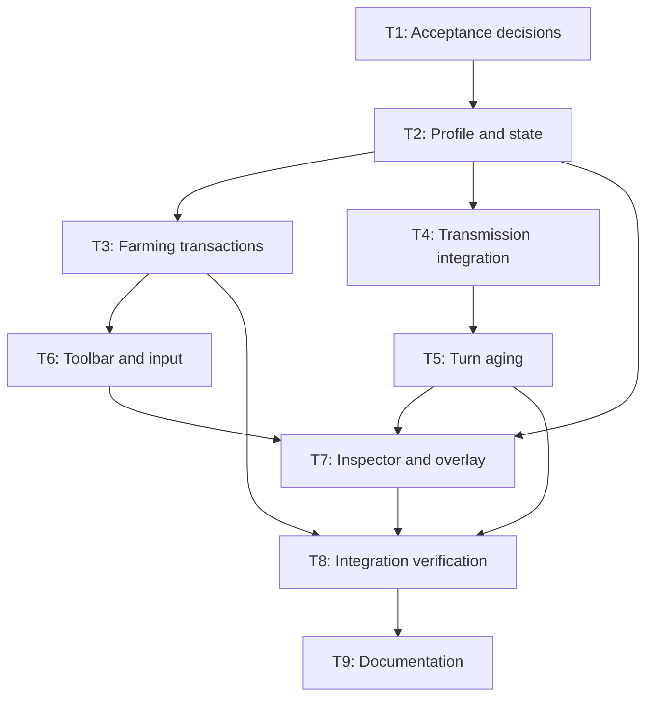

# Seed inoculation implementation tasks

All tasks are pending. Dependencies are prerequisites for completion and integration.

| ID | Task | Depends on | Requirements | Done when |
|---|---|---|---|---|
| T1 | Resolve feature ambiguities and add concrete duration/SEIR acceptance examples | — | R1–R5 | Proposed defaults are encoded as explicit test expectations; invalid placeholder is resolved |
| T2 | Add validated profile and cell protection state | T1 | R5, R6, R10 | Defaults, validation, copying, reset, and boundary tests pass |
| T3 | Implement farming action and lifecycle handling | T2 | R1–R3, R6 | Immediate/queued commit, rejection, reapplication, transfer, removal, and stale-action tests pass |
| T4 | Integrate recipient protection into shared transmission and model callers | T2 | R4, R10 | SIR/SEIR numerical comparisons and CA/neutral/cap regression checks pass |
| T5 | Implement transactional turn aging and weather decay | T4 | R5, R6 | Exactly-once aging, three-transition lifetime, early decay expiration, and rollback tests pass |
| T6 | Wire toolbar, cursor, and queued input | T3 | R3, R7 | Saved scene and setup tools select and execute Inoculate correctly |
| T7 | Add inspector feedback and protection overlay | T2, T5, T6 | R2, R8, R9 | Status, errors, percentages, countdown, and expiration refresh correctly |
| T8 | Complete end-to-end regression and rendered verification | T3, T5, T7 | R1–R10 | Feature scenarios covered, strict runner results recorded, visual checks complete |
| T9 | Document controls, configuration, and verified limitations | T8 | R1–R10 | Documentation describes implemented behavior and actual verification results |

## Dependency graph

## Execution checklist

- [ ] T1: Acceptance decisions and feature clarification
- [ ] T2: Profile and state
- [ ] T3: Farming transactions and lifecycle
- [ ] T4: Transmission integration
- [ ] T5: Turn aging and weather decay
- [ ] T6: Toolbar, cursor, and input
- [ ] T7: Inspector and overlay
- [ ] T8: Integration, regression, and visual verification
- [ ] T9: Documentation

T3 and T4 can proceed independently after T2; T6 and T5 can likewise proceed independently. No runtime implementation is included in this specification deliverable.
