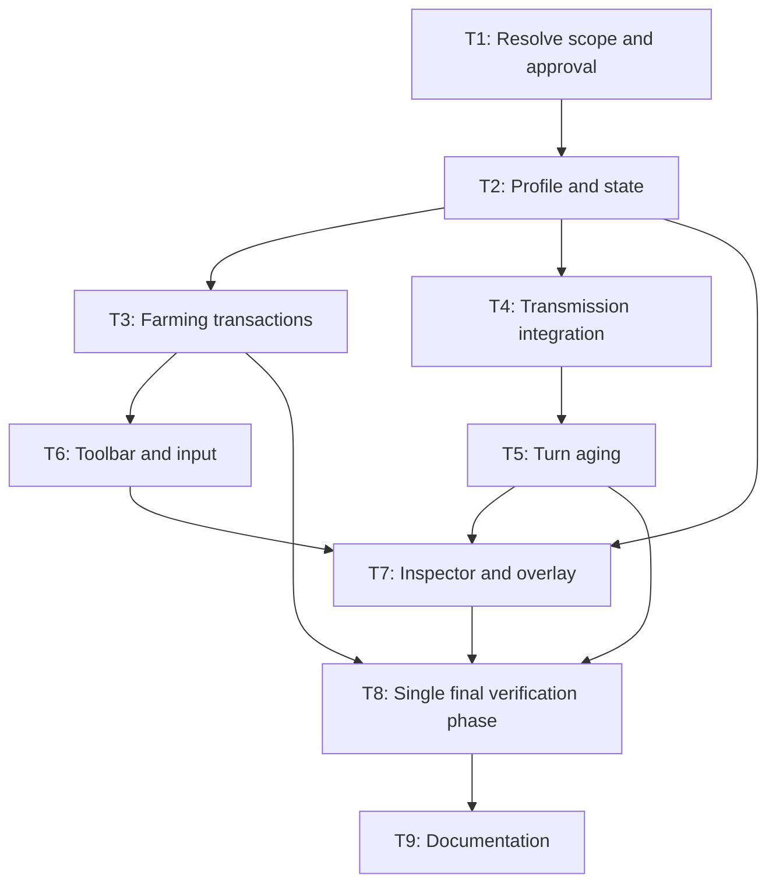

# Seed inoculation implementation tasks

Implementation status as of 2026-11-10 is recorded below. Dependencies are prerequisites for implementation and integration. Follow `AGENTS.md`, `.agents/spec-driven-workflow.md`, `.agents/architecture.md`, and `.agents/testing-guidelines.md`.

## Execution rules

- Acceptance scope: cover every scenario in the three inoculation feature files and maintain R1–R10 task/test traceability. Gameplay values are fictional. Inventory treatment, new autoloads, and unrelated refactors are outside scope.
- Before dependent implementation, T1 must distinguish source requirements, verified implementation, and unresolved proposals. Duration, moisture bounds, weather decay, reapplication, additional-stage handling, and CA scope in requirements.md remain proposals until resolved with the user. Obtain approval for the concrete cross-layer design unless already authorized; do not request it again for an approved design.
- Preserve Presentation → Logic → Simulation → Data dependencies, detached snapshots, copy/validate/commit transactions, and rollback of state, RNG, counters, and clock. Append enum values; use typed GDScript, `PackedStringArray` validation, and `last_error` for rejections.
- Author tests alongside T2–T7 but do not execute them individually. Run the registered suite once in T8 after all implementation and test authoring is complete. Earlier execution is allowed only on explicit request or to debug a concrete problem; after final-phase failures rerun affected checks, repeating the full suite only when justified.
- Use exported Inspector references, configuration validation, and `_connect_once` wiring. Edit scenes/resources only through Godot Editor APIs or established setup tools; never hand-edit `.tscn`/`.tres`, overwrite tuned assets, or save authored assets from tests.

Implementation-ready gates below do not establish verified completion: behavioral checkboxes remain pending until T8 supplies acceptance evidence.

| ID | Task | Depends on | Requirements | Done when |
|---|---|---|---|---|
| T1 | Inspect relevant repo-findings.md entries and implementation; resolve proposals and cross-layer scope; update approved specs and Gherkin | — | R1–R10 | Decisions and authorization recorded, duration placeholder resolved, SEIR criteria explicit, plan states scope/files/dependencies/verification in at most five bullets |
| T2 | Add validated profile and cell protection state | T1 | R5, R6, R10 | Code and tests authored for defaults, validation, detached copying, reset, and boundaries; execution deferred to T8 |
| T3 | Implement farming action and lifecycle handling | T2 | R1–R3, R6 | Code and tests authored for queued commit, rejection without mutation, reapplication, transfer, removal, cancellation, and stale actions |
| T4 | Integrate recipient protection into shared transmission and approved model callers | T2 | R4, R10 | Code and deterministic tests authored for SIR/SEIR, approved CA scope, neutral behavior, caps, and compartment invariants |
| T5 | Implement transactional turn aging and approved weather decay | T4 | R5, R6 | Code and tests authored for exactly-once aging, approved lifetime boundaries, decay, and rollback including RNG/counters/clock |
| T6 | Wire toolbar, cursor, and queued input through exported references | T3 | R3, R7 | Editor-authored scene/setup wiring and input tests prepared; authored assets preserved |
| T7 | Add inspector feedback and protection overlay | T2, T5, T6 | R2, R8, R9 | Code and tests authored for status, errors, percentages, countdown, and expiration; all new executables registered |
| T8 | Run the single final verification phase and acceptance-focused interactive checks | T3, T5, T7 | R1–R10 | Registered suite outcomes mapped to criteria; appearance/input inspected; failures, untested Android scenarios, and blockers explicitly recorded |
| T9 | Document controls, configuration, verification, and remaining gaps | T8 | R1–R10 | Changed files, commands, actual outcomes, and limitations reported; only verified tasks marked complete; relevant facts updated in their owning context file |

## Dependency graph

## Execution checklist

- [x] T1: Acceptance decisions and feature clarification — user approved proposed settings; preserve saved 9x9 scene
- [x] T2: Profile and state — strict logic check passes
- [x] T3: Farming transactions and lifecycle — strict logic check passes
- [x] T4: Transmission integration — deterministic SIR/SEIR and CA caller checks pass
- [x] T5: Turn aging and weather decay — expiration and rollback checks pass
- [x] T6: Toolbar, cursor, and input — saved wiring and farmer-arrival assertions pass; rendered placement reviewed
- [x] T7: Inspector and overlay — status, errors, toggle, and expiration assertions pass
- [ ] T8: Integration, regression, and visual verification
- [ ] T9: Final handoff after T8 — controls/configuration and current limitations documented in docs/SEED_INOCULATION.md

T3 and T4 can proceed independently after T2; T6 and T5 can likewise proceed independently. This describes dependency ordering, not a requirement to delegate to agents.

T8 evidence: the full registered suite ran once; the corrected inoculation logic check passes strictly. UI assertions pass but the strict scene check fails on terrain atlas diagnostics. Existing suite assertions also fail in unrelated feature areas. Rendered desktop output was inspected; physical Android checks remain outstanding. See docs/SEED_INOCULATION.md for commands and limitations. Completed implementation checkboxes do not imply a green full suite.

## T8 verification procedure

1. Use the custom Godot harness, not GUT/GdUnit. Reuse `gameplay_test_fixture.gd` (`prepare` before adding the scene, then `start`), `queued_action_test_driver.gd` (`finish`), inspector fixtures, and `root.push_input` where applicable. Register executable tests in `tools/run_tests.py`; helpers are not executable tests.
2. After all implementation is ready and project/assets are imported with a compatible editor, run `python tools/run_tests.py --godot 'C:\path\to\Godot.exe'` once. Require exit zero, a suite `_PASS` marker, and no `ERROR:`, `WARNING:`, or `FAIL:` diagnostics. Use the runner's editor plugin route rather than `--editor --script`.
3. Inspect toolbar/cursor, application feedback, inspector layout, and overlay visibility/expiration interactively. Record Android input as unverified unless exercised. Headless results alone do not establish visual or mobile acceptance.
4. On failures, repair within scope and rerun affected registered checks using `--test`; broaden only when necessary. Preserve logs and report current results without substituting historical test counts.
5. Clean up nodes and temporary test files. Tests must not save authored scenes/resources; use isolated `user://` or `.godot/` paths for persistence.

For this task-spec-only update, perform content/link review; no game test run is required.
