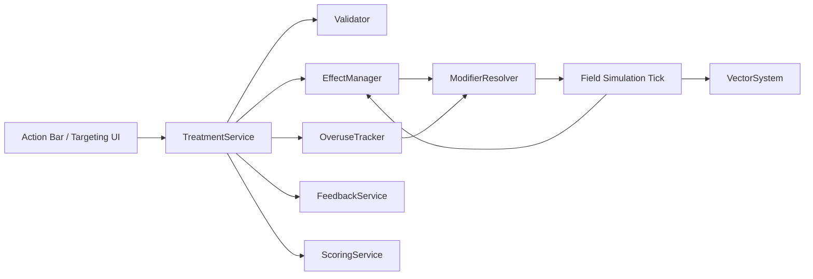

# Design Document

## Overview

Data-driven treatment system. Each treatment is a definition in config. Applying one creates an `ActiveEffect` over target cells. Each tick, effects are resolved into per-cell modifiers consumed by the transmission, recovery, susceptibility, resilience, vitality, and vector models.

Engine-agnostic. Pseudocode uses TypeScript-style types.

## Architecture



## Components

### TreatmentRegistry
Holds `TreatmentDef` records loaded from config.

### Validator
Checks, in order: actions remaining, cooldown, cost, target shape and bounds. Disease-type match is evaluated per cell after these pass.

### TreatmentService
`apply(treatmentId, targetCell, state) -> ApplyResult`
1. Validate.
2. Spend cost and action, start cooldown.
3. Compute affected cells from target shape.
4. Split cells into matching and mismatching by disease type.
5. Create or refresh effects on matching cells.
6. Emit feedback events; record mistakes for mismatches.

### EffectManager
- Stores `ActiveEffect` per (cell, treatmentClass).
- Same class: refresh duration to max, no stacking.
- Different class: coexist.
- `tick()` decrements and expires.

### ModifierResolver
Combines active effects into `CellModifiers`, multiplicatively across classes, then applies resistance scaling and clamps.

### OveruseTracker
Rolling-window usage count per class. Computes `effectiveness(class)` in [floor, 1]. Decays when unused.

### VectorSystem (extension)
Supports `killVectors(area)`, `suppressInflow(area, turns)`, beneficial index, and rebound.

### FeedbackService
Emits `EffectApplied`, `NoEffect(mismatch)`, `EffectExpired`, `ResistanceWarning`.

## Data Models

```ts
type DiseaseType = 'fungal' | 'bacterial' | 'viral' | 'vector';
type TargetShape = 'cell' | 'area3x3' | 'cellOrArea';
type TreatmentClass =
  | 'fungicide' | 'bactericide' | 'insecticide'
  | 'protectant' | 'enhancer';

interface TreatmentDef {
  id: TreatmentClass;
  category: 'reactive' | 'proactive';
  target: TargetShape;
  cost: number;
  cooldown: number;          // turns
  duration: number;          // turns
  allowedDiseases: DiseaseType[] | 'all';
  appliesTo: 'infected' | 'healthy' | 'any';
  effects: EffectSpec;
  resistanceGroup?: 'fungicide' | 'bactericide' | 'insecticide';
}

interface EffectSpec {
  transmissionMult?: number;       // fungicide, bactericide: 0.5
  recoveryMult?: number;           // fungicide, bactericide: 0.7
  susceptibilityMult?: number;     // protectant: 0.6
  resilienceBonus?: number;        // enhancer
  vitalityLossMult?: number;       // enhancer: e.g. 0.7
  killVectors?: boolean;           // insecticide
  suppressVectorInflow?: boolean;  // insecticide
  beneficialInsectDelta?: number;  // insecticide: negative
}

interface ActiveEffect {
  class: TreatmentClass;
  cell: CellId;
  remainingTurns: number;
  appliedTurn: number;
  strength: number; // effectiveness at application time
}

interface CellModifiers {
  transmissionMult: number;     // default 1
  recoveryMult: number;         // default 1
  susceptibilityMult: number;   // default 1
  resilienceBonus: number;      // default 0
  vitalityLossMult: number;     // default 1
  vectorInflowBlocked: boolean;
}

interface FieldTreatmentState {
  actionsRemaining: number;
  cooldowns: Record<TreatmentClass, number>;
  usageLog: Record<string, number[]>;      // turns used, per resistance group
  beneficialIndex: Record<AreaId, number>; // 0..1
  pendingRebound: ReboundEvent[];
}
```

## Treatment Definitions (defaults, tunable)

| Class | Target | Applies to | Disease | Duration | Key effect |
|---|---|---|---|---|---|
| fungicide | 3x3 | infected | fungal | 3 | transmission x0.5, recovery x0.7 |
| bactericide | 3x3 | infected | bacterial | 3 | transmission x0.5, recovery x0.7 |
| insecticide | 3x3 | any | vector-borne | 2 | kill vectors, block inflow, beneficial index down |
| protectant | 3x3 | healthy | fungal | 4 | susceptibility x0.6 |
| enhancer | cell or 3x3 | any | all | 5 | resilience up, vitality loss x0.7 |

## Algorithms

### Effect resolution
```
mods = defaults
for effect in effectsOn(cell):            # at most one per class
  s = effect.strength * effectiveness(effect.class)
  mods.transmissionMult   *= lerp(1, spec.transmissionMult, s)
  mods.recoveryMult       *= lerp(1, spec.recoveryMult, s)
  mods.susceptibilityMult *= lerp(1, spec.susceptibilityMult, s)
  mods.resilienceBonus    += spec.resilienceBonus * s
  mods.vitalityLossMult   *= lerp(1, spec.vitalityLossMult, s)
clamp(mods, bounds)
```

### Overuse
```
uses = count(usageLog[group] within window)
over = max(0, uses - threshold)
effectiveness = max(floor, 1 - perOverusePenalty * over)
```
Defaults: window 10 turns, threshold 2, penalty 0.15 per extra use, floor 0.4. Unused turns drop old log entries, so resistance decays.

### Insecticide rebound
On expiry: `vectors(area) += baseline * (1 - beneficialIndex) * reboundFactor`. Beneficial index recovers slowly each tick.

### Enhancer diminishing returns
Strength is multiplied by `0.7^n`, where n = enhancer uses on that cell within the window.

## Tick Order

1. Resolve modifiers.
2. Run disease transmission, recovery, vitality, growth.
3. Run vector update (kills, inflow suppression, rebound).
4. Decrement effect durations; expire; emit events.
5. Decrement cooldowns; decay resistance.
6. Reset actions for next turn.

## Error Handling

| Case | Result |
|---|---|
| No actions left / cooldown / cannot afford | Reject, no state change, UI cue |
| Target out of bounds | Clip area to field |
| Mismatched disease on cell | No effect on cell, cost spent, mistake recorded |
| Empty cell (roguing removed crop) | Skip |
| Config missing field | Fail at load with clear error |

## Correctness Properties

1. **No-stack:** For one cell and class, applying twice never yields a stronger modifier than once.
2. **Mismatch no-op:** A treatment on a non-matching cell leaves its modifiers unchanged.
3. **Bounds:** Resolved modifiers always lie within configured clamps.
4. **Expiry:** After `duration` ticks, the effect's modifiers are gone.
5. **Monotonic resistance:** More uses within the window never increases effectiveness.
6. **Enhancer neutrality:** Enhancer never changes infection status.
7. **Determinism:** Same seed and actions give the same field state.
8. **Cost accounting:** Rejected actions never spend resources.

## Testing Strategy

- **Unit:** validator, each treatment definition, resolver math, overuse curve.
- **Property-based:** properties above with random fields, action sequences, and seeds.
- **Integration:** full tick with mixed diseases; insecticide plus barrier; protectant then outbreak.
- **Balance simulation:** scripted bots (no treatment, spam, optimal) compared by final yield.
- **UI:** snapshot tests of indicators and cues.
