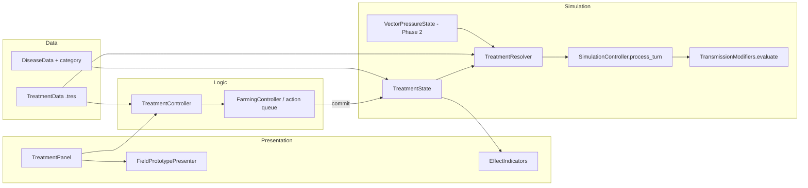

# Design Document

## Overview

This design follows the project's four-layer architecture (Data, Simulation, Logic, Presentation) and typed GDScript conventions. Treatments are data resources. They enter the game as queued field actions, commit through the farmer walker pattern, and write per-cell `TreatmentEffect` records. Each turn, a resolver turns those records into `TreatmentModifiers` that feed `TransmissionModifiers.evaluate` inside `SimulationController.process_turn`.

Phase 1 covers taxonomy, queue integration, four treatments, and resistance. Phase 2 adds a minimal vector-pressure model for Insecticide.

### Verification Notes

All paths and integration points confirmed by direct codebase inspection during Task 1.

| Item | Status |
|---|---|
| `src/data/resources/disease_data.gd` (`DiseaseData`) | Confirmed |
| `src/data/state/field_cell_state.gd` (`FieldCellState`) | Confirmed |
| `src/data/state/field_grid_state.gd` (`FieldGridState`) | Confirmed |
| `src/simulation/simulation_controller.gd` (`SimulationController`) | Confirmed |
| `src/simulation/models/transmission_modifiers.gd` (`TransmissionModifiers`) | Confirmed |
| `src/data/enums/simulation_enums.gd` (`SimulationEnums.FieldActionKind`) | Confirmed; current max = 7 (FERTILIZE) |
| `docs/QUEUED_FIELD_ACTIONS.md` | Confirmed |
| `src/simulation/models/crop_growth_model.gd` (`CropGrowthModel`) | Confirmed; vitality loss = `stress * vitality_loss_per_turn` |
| Save serialization of field state | No save system exists; TreatmentState provides `to_dict`/`from_dict` |
| `src/logic/farming/farming_controller.gd` (`FarmingController`) | Confirmed; enqueue/arrive/commit/cancel APIs |
| `src/simulation/models/compartment_math.gd` (`CompartmentMath`) | Confirmed; gamma used in `continuous()` |
| `src/simulation/models/spatial_sir_model.gd`, `spatial_seir_model.gd`, `stochastic_ca_sir_model.gd` | Confirmed |

## Architecture



## Components and Target Files

New files use proposed paths. Align folder names with the existing tree during Task 1.

| Layer | Component | File |
|---|---|---|
| Data | `DiseaseData` (modify) | `src/data/resources/disease_data.gd` |
| Data | `DiseaseCategory` enum | `src/data/enums/` *(confirm)* or inside `SimulationEnums` |
| Data | `TreatmentData` resource | `src/data/resources/treatment_data.gd` |
| Data | Treatment definitions | `src/data/treatments/*.tres` |
| Simulation | `TreatmentEffect` | `src/simulation/treatment/treatment_effect.gd` |
| Simulation | `TreatmentState` | `src/simulation/treatment/treatment_state.gd` |
| Simulation | `TreatmentResolver` | `src/simulation/treatment/treatment_resolver.gd` |
| Simulation | `TreatmentModifiers` | `src/simulation/treatment/treatment_modifiers.gd` |
| Simulation | `VectorPressureState` (Phase 2) | `src/simulation/treatment/vector_pressure_state.gd` |
| Simulation | `SimulationEnums.FieldActionKind` (extend) | existing file |
| Logic | `TreatmentController` | `src/logic/treatment/treatment_controller.gd` |
| Presentation | `TreatmentPanel`, indicators, cues | `src/presentation/treatment/` |
| Acceptance | Gherkin | `features/treatments.feature` |

## Data Layer

### Disease taxonomy (Req 11)

```gdscript
# disease_data.gd (additions)
enum DiseaseCategory { FUNGAL = 0, BACTERIAL = 1, VIRAL = 2 }

@export var disease_category: DiseaseCategory = DiseaseCategory.FUNGAL
@export var is_vector_borne: bool = false
```

Mapping for known diseases:

| disease_id | category | vector-borne |
|---|---|---|
| RICE_BLAST | FUNGAL | no |
| BACTERIAL_LEAF_BLIGHT | BACTERIAL | no |
| RICE_TUNGRO | VIRAL | yes |
| others | set per resource in Task 2 | set per resource |

The old four-way label (fungal / bacterial / viral / vector) is replaced by one category plus a vector flag. This avoids tungro being both "viral" and "vector" as separate classes. Viral cells have no dedicated treatment; Enhancer applies, and Insecticide applies when `is_vector_borne` is true. The default of `FUNGAL` is a placeholder; validation in Task 2 must fail on resources that were never classified (use an `UNSET = -1` sentinel if the default would hide mistakes).

### Treatment definition (Req 2, 3-6, 12)

```gdscript
class_name TreatmentData extends Resource

enum TargetMode { AREA, CELL_OR_AREA }
enum AppliesTo { INFECTED, HEALTHY_OR_PRE_INFECTION, ANY }
enum ResistanceGroup { NONE, FUNGICIDE, BACTERICIDE }

@export var treatment_id: StringName
@export var cost: int
@export var cooldown_turns: int
@export var duration_turns: int
@export var target_mode: TargetMode = TargetMode.AREA
@export var area_radius: int = 1                      # 1 = 3x3
@export var applies_to: AppliesTo = AppliesTo.ANY
@export var allowed_categories: Array[int] = []       # DiseaseCategory values; empty = any
@export var requires_vector_borne: bool = false
@export var resistance_group: ResistanceGroup = ResistanceGroup.NONE

# Multipliers; 1.0 / 0.0 = no effect
@export var hazard_mult: float = 1.0                  # transmission
@export var susceptibility_mult: float = 1.0          # applied to hazard, not to fractions
@export var recovery_period_mult: float = 1.0         # gamma_scale = 1 / this
@export var resilience_bonus: float = 0.0             # hazard *= (1 - bonus)
@export var vitality_loss_mult: float = 1.0
@export var vector_pressure_override: float = -1.0    # >= 0 sets pressure (Insecticide = 0)
@export var beneficial_index_delta: float = 0.0
```

Defaults:

| treatment_id | duration | applies_to | categories | hazard | susceptibility | recovery_period | resilience | vitality loss |
|---|---|---|---|---|---|---|---|---|
| fungicide | 3 | INFECTED | FUNGAL | 0.5 | 1.0 | 0.7 | 0 | 1.0 |
| bactericide | 3 | INFECTED | BACTERIAL | 0.5 | 1.0 | 0.7 | 0 | 1.0 |
| protectant | 4 | HEALTHY_OR_PRE_INFECTION | FUNGAL | 1.0 | 0.6 | 1.0 | 0 | 1.0 |
| enhancer | 5 | ANY | any | 1.0 | 1.0 | 1.0 | 0.15 | 0.7 |
| insecticide (Phase 2) | 2 | ANY | any + vector-borne | 1.0 | 1.0 | 1.0 | 0 | 1.0 |

Global tunables (single resource, e.g. `treatment_config.tres`): `max_queued_per_turn` (2-3), resistance `window_turns` (10), `threshold` (2), `penalty_per_extra_use` (0.15), `potency_floor` (0.4), enhancer `repeat_decay` (0.7), multiplier clamps (hazard product min 0.2), rebound and beneficial-index values (Phase 2).

## Simulation Layer

### State

```gdscript
class_name TreatmentEffect extends RefCounted
var treatment_id: StringName
var cell: Vector2i
var remaining_turns: int
var potency: float          # fixed at apply time: resistance effectiveness or enhancer decay
var applied_turn: int

class_name TreatmentState extends RefCounted
var effects: Dictionary = {}          # key: "cell_x:cell_y:treatment_id" or nested Dictionary
var cooldowns: Dictionary = {}        # treatment_id -> turns left
var usage_log: Dictionary = {}        # ResistanceGroup -> Array[int] of turns
var enhancer_uses: Dictionary = {}    # Vector2i -> Array[int] of turns
var mistakes: Array[Dictionary] = []  # {treatment_id, disease_id, cell, turn}
```

`potency` is set once at application. Resolution never re-multiplies resistance, which removes the double-counting risk. `enhancer_uses` holds per-cell history for the 0.7 decay.

`to_dict()` / `from_dict()` serialize everything; missing keys load as empty (older saves).

### Commit: applying a treatment (Req 1, 2, 7, 8)

```gdscript
func commit_treatment(data: TreatmentData, target: Vector2i, grid: FieldGridState, turn: int) -> CommitResult
```

1. Re-validate cooldown and cost; on failure return `DISCARDED` with no state change.
2. Compute cells: `[target]` for single-cell Enhancer, else the square of `area_radius`, clipped to the grid. Skip emptied cells.
3. Classify each cell as MATCH, MISMATCH, or NOOP:
   - Disease lookup: `FieldCellState.active_disease_id` → `DiseaseData`.
   - Curative (`INFECTED`): healthy cell → NOOP, no mistake; infected and category not allowed → MISMATCH.
   - Preventive (`HEALTHY_OR_PRE_INFECTION`): healthy → MATCH; infected with a non-FUNGAL disease → MISMATCH.
   - `ANY` (Enhancer): MATCH.
   - Insecticide: infected and `is_vector_borne` → MATCH; infected, not vector-borne → MISMATCH; healthy → NOOP.
4. Compute `potency`: resistance effectiveness for the group (Req 8), or `repeat_decay ^ n` for the Enhancer on that cell.
5. For each MATCH cell, create or refresh the effect: same class refreshes `remaining_turns` to `duration_turns` and keeps `max(potency)`.
6. Deduct cost, start cooldown, append to `usage_log`, append mistakes, return per-cell results for cues.

Cost and cooldown are charged even if every cell mismatches (Req 2.3).

### Resolution (Req 7, 9)

```gdscript
class_name TreatmentModifiers extends RefCounted
var hazard_mult: float = 1.0        # transmission x susceptibility x (1 - resilience) x vector pressure
var gamma_scale: float = 1.0
var vitality_loss_mult: float = 1.0
```

```gdscript
func resolve(cell: Vector2i, state: TreatmentState, config: TreatmentConfig) -> TreatmentModifiers:
    var m := TreatmentModifiers.new()
    for e in state.effects_on(cell):
        var d := config.get_data(e.treatment_id)
        m.hazard_mult *= lerpf(1.0, d.hazard_mult, e.potency)
        m.hazard_mult *= lerpf(1.0, d.susceptibility_mult, e.potency)
        m.hazard_mult *= 1.0 - d.resilience_bonus * e.potency
        m.gamma_scale *= lerpf(1.0, 1.0 / d.recovery_period_mult, e.potency)
        m.vitality_loss_mult *= lerpf(1.0, d.vitality_loss_mult, e.potency)
    m.hazard_mult = maxf(m.hazard_mult, config.min_hazard_mult)
    m.gamma_scale = minf(m.gamma_scale, config.max_gamma_scale)
    return m
```

### Integration with `process_turn` (Req 9)

Recovery is a rate, so "recovery period -30%" becomes `gamma_eff = gamma * gamma_scale` with `gamma_scale = 1 / 0.7`. Susceptibility is a compartment fraction that must sum to 1.0, so it is never scaled. Instead it scales the cell's infection hazard.

1. Snapshot start-of-turn state (existing).
2. For each cell: `mods = TreatmentResolver.resolve(...)`.
3. Call `TransmissionModifiers.evaluate(..., mods)`. New optional parameter (default `null` = no change). Inside: `effective_beta *= mods.hazard_mult` and, for the recovery step, `gamma *= mods.gamma_scale`. Where hazard is derived from beta, the multiplier is applied once, to the final hazard, not to beta and hazard both. Task 6 confirms which one `Result` carries.
4. Advance compartments and commit (existing). Validation (`FieldCellState.validate()`) is unchanged.
5. `TreatmentState.advance_turn()`: decrement `remaining_turns`, drop expired effects (emit events), decrement cooldowns, prune `usage_log` and `enhancer_uses` older than the window, apply rebound events (Phase 2).

Vitality: if Task 1 finds vitality loss computed in `crop_growth_model.gd` (or elsewhere), pass `vitality_loss_mult` to that call. If vitality loss is not implemented, the Enhancer's vitality effect (Req 6.3) is skipped and only the hazard effect applies. The `WHERE` clause in Req 6.3 covers this.

### Resistance (Req 8)

```
uses       = count(usage_log[group] within window_turns)
over       = max(0, uses - threshold)
potency    = max(potency_floor, 1.0 - penalty_per_extra_use * over)
```

Fungicide and Protectant share `FUNGICIDE`; Bactericide has `BACTERICIDE`. Enhancer and Insecticide use `NONE`. Decay happens as entries age out of the window.

### Vector pressure (Phase 2, Req 12)

No vector simulation exists. This design adds a lightweight scalar model, not individual agents.

```gdscript
class_name VectorPressureState extends RefCounted
var pressure: Dictionary = {}           # Vector2i -> float [0,1], default baseline
var beneficial_index: Dictionary = {}   # Vector2i -> float [0,1], default 1.0
var suppressed_until: Dictionary = {}   # Vector2i -> turn
var pending_rebounds: Array[Dictionary] = []  # {cells: Array[Vector2i], due_turn: int}
```

- Hazard for vector-borne diseases is multiplied by the cell's `pressure` (non-vector-borne diseases ignore it). Baseline pressure per disease/level is data (tunable).
- Insecticide sets pressure to 0 and `suppressed_until = turn + 2`, and lowers `beneficial_index` by `beneficial_index_delta`.
- Per turn, pressure grows toward baseline at `growth * (1 + (1 - beneficial_index))`.
- On expiry: `pressure += rebound_factor * (1 - beneficial_index)`, so each use lowers the index and the next rebound is larger.
- Beneficial index recovers by a small step each turn.
- Where vector pressure is not data-driven for a level (no vector-borne disease), the state is empty and costs nothing.

This is new simulation work. It is scoped as Tasks 18-20 and can ship after Phase 1.

## Logic Layer

### Action queue integration (Req 1)

Per `docs/QUEUED_FIELD_ACTIONS.md`, actions are enqueued, the walker travels, and the action commits. Next Turn is blocked until the queue is empty. Treatments use the same path.

```gdscript
# SimulationEnums.FieldActionKind: append only, keep existing values
APPLY_FUNGICIDE = <next>,
APPLY_BACTERICIDE = <next+1>,
APPLY_PROTECTANT = <next+2>,
APPLY_ENHANCER = <next+3>,
APPLY_INSECTICIDE = <next+4>,   # Phase 2
```

Explicit numeric values are assigned after reading the current maximum (Task 7). No existing value changes.

```gdscript
class_name TreatmentController extends RefCounted
func can_enqueue(treatment_id: StringName, target: Vector2i) -> ValidationResult  # cooldown, cost, queue cap, bounds
func preview(treatment_id: StringName, target: Vector2i) -> Array[CellPreview]    # MATCH / MISMATCH / NOOP
func enqueue(treatment_id: StringName, target: Vector2i) -> bool
```

Decisions: cost is checked at enqueue and again at commit, and charged only at commit. The queue cap counts treatment actions only. If the queue API cannot cancel, a discarded commit is the only failure path (Req 1.7).

## Presentation Layer

- `TreatmentPanel`: list treatments with cost, cooldown, queue slots left, resistance bar per group.
- Preview overlay: MATCH, MISMATCH, NOOP tint per cell via `FieldPrototypePresenter`.
- Cues: effect animation on commit, distinct no-effect cue, expiry cue.
- Active effect badge with remaining turns.

## Design Decisions and Rationale

| Decision | Rationale |
|---|---|
| Category + vector flag instead of four types | Matches real diseases; tungro is viral and vector-borne |
| Susceptibility folded into hazard | Susceptible fraction is constrained to sum to 1.0 |
| Recovery as `gamma` scaling (x 1/0.7) | Recovery is a rate in the model |
| `potency` fixed at application | Avoids double-applying resistance |
| Treatments only via queue/commit | Respects existing turn gating and walker |
| Cost at commit | Avoids refunds when the queue cannot cancel |
| Vector pressure as scalar field | Smallest model that gives Insecticide a target |
| Scoring out of scope; mistakes logged | No scoring system exists |
| Insecticide excluded from resistance | Its penalty is rebound |
| Append-only enum values | Save compatibility |
| Area as `area_radius` | Area size is tunable |

## Requirements Traceability

| Req | Component |
|---|---|
| 1 | `TreatmentController`, queue, `FieldActionKind`, `commit_treatment` |
| 2 | `commit_treatment` classification, `DiseaseData`, mistake log |
| 3-4 | `TreatmentData`, `TreatmentResolver`, `process_turn` integration |
| 5 | `TreatmentData` (protectant), hazard path |
| 6 | `TreatmentData` (enhancer), `enhancer_uses`, vitality hook |
| 7 | `TreatmentState` refresh rule, resolver product and clamps |
| 8 | Resistance formula, `usage_log`, panel indicator |
| 9 | `process_turn` changes, `advance_turn`, save/load |
| 10 | Presentation cues and badges |
| 11 | `DiseaseData` additions and validation |
| 12 | `VectorPressureState`, Insecticide data |

## Error Handling

| Case | Result |
|---|---|
| Cooldown, cost, or queue cap fails at enqueue | Reject with reason; no state change |
| Cost or cooldown fails at commit | Discard with cue; no state change |
| Target outside grid | Clip area; ignore cells outside |
| Cell emptied (e.g. roguing, from another spec) | Skip |
| Mismatch | No effect on cell; cost spent; mistake logged |
| Missing disease category on a resource | Fail at load |
| Old save without treatment state | Load empty treatment state |

## Correctness Properties

1. **No stacking:** Same class twice on a cell never gives a stronger modifier than once.
2. **Mismatch no-op:** A mismatched cell's modifiers are unchanged.
3. **Invariant:** Compartment fractions still sum to 1.0 after treated turns.
4. **Bounds:** Resolved multipliers stay within configured clamps.
5. **Expiry:** Effects vanish after exactly `duration_turns` completed turns.
6. **Monotonic resistance:** More uses in the window never raise potency.
7. **Enhancer neutrality:** Enhancer never changes infection status or gamma.
8. **Determinism:** Same seed and actions give the same state.
9. **Cost accounting:** Rejected or discarded actions never spend resources.
10. **Queue gating:** No treatment takes effect without a commit.
11. **Save round-trip:** `from_dict(to_dict(x))` equals `x`.

## Testing Strategy

- **Unit (GUT or the project's runner):** classification, resolver math, resistance curve, enum value preservation.
- **Property-based:** the properties above with random grids and action sequences.
- **Integration:** `process_turn` with treated cells; queue to commit flow; save/load.
- **Gherkin:** scenarios in `features/treatments.feature` bound to step definitions.
- **Balance bots:** no treatment, spam, targeted; confirm spam is not optimal.
- **Presentation:** snapshot tests for the panel, preview tint, and badges.
