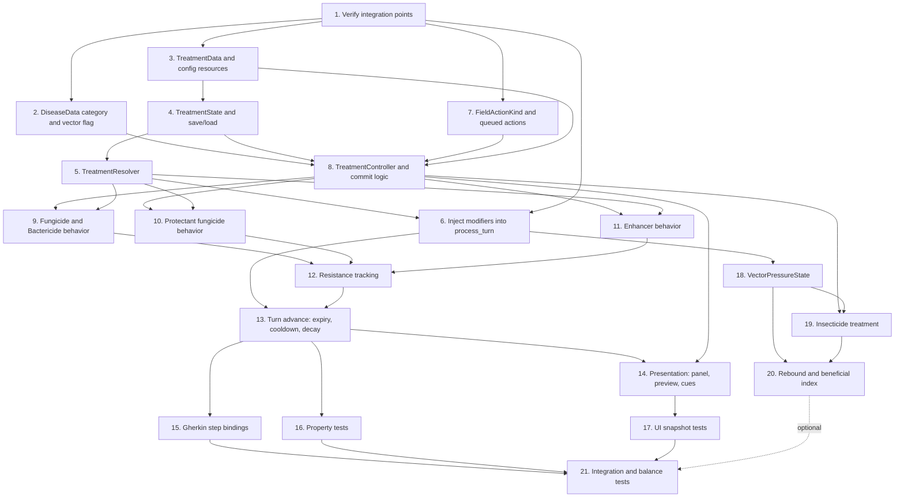

# Implementation Plan

Phase 1 = Tasks 1-17 and 21 (without insecticide scenarios). Phase 2 = Tasks 18-20.

## Task Dependency Graph

### Dependency Table

| Task | Depends on | Can run in parallel with |
|---|---|---|
| 1 | none | none |
| 2 | 1 | 3, 7 |
| 3 | 1 | 2, 7 |
| 4 | 3 | 2, 7 |
| 5 | 4 | 2, 7 |
| 6 | 1, 5 | 8 |
| 7 | 1 | 2, 3, 4, 5 |
| 8 | 2, 3, 4, 7 | 5, 6 |
| 9 | 5, 8 | 10, 11 |
| 10 | 5, 8 | 9, 11 |
| 11 | 5, 8 | 9, 10 |
| 12 | 9, 10, 11 | none |
| 13 | 6, 12 | none |
| 14 | 8, 13 | 15, 16 |
| 15 | 13 | 14, 16 |
| 16 | 13 | 14, 15 |
| 17 | 14 | none |
| 18 | 6 | 8-17 |
| 19 | 8, 18 | 12-17 |
| 20 | 18, 19 | 14-17 |
| 21 | 15, 16, 17 (20 optional) | none |

### Critical Path
1 → 3 → 4 → 5 → 8 → 9/10/11 → 12 → 13 → 14 → 17 → 21 (11 tasks).

The alternative branch 13 → 15/16 → 21 is one task shorter.

## Tasks

- [x] 1. Verify integration points
  - Located and recorded file paths for `FieldCellState`, `FieldGridState`, `SimulationController`, `TransmissionModifiers`, `SimulationEnums`.
  - Read `TransmissionModifiers.evaluate` and `Result`; `hazard_mult` applies to the final `result.hazard` (not beta); `gamma_scale` applies in `CompartmentMath.continuous` and CA model.
  - Vitality loss is computed in `crop_growth_model.gd` (`stress * vitality_loss_per_turn`); `vitality_loss_mult` passed per cell.
  - Read `docs/QUEUED_FIELD_ACTIONS.md` and the walker/queue code; enqueue/arrive/commit/cancel APIs in `FarmingController`.
  - No save system exists; `TreatmentState.to_dict`/`from_dict` is the save interface.
  - All 9 `DiseaseData` resources listed and categorized.
  - Read `.kiro/steering/game-acceptance-criteria.md` and the sibling spec.
  - Updated the "confirm" markers in `requirements.md`.
  - _Requirements: all (grounding)_

- [x] 2. DiseaseData category and vector flag
  - [x] 2.1 Add `DiseaseCategory` enum, `disease_category`, `is_vector_borne` to `disease_data.gd` (UNSET = -1 sentinel).
  - [x] 2.2 Populate every existing resource (RICE_BLAST fungal, BACTERIAL_LEAF_BLIGHT bacterial, RICE_TUNGRO viral + vector-borne, RSSI viral + vector-borne, others per review).
  - [x] 2.3 Fail validation on unset category (for saved resources with resource_path).
  - [x] 2.4 Unit tests for every resource.
  - _Requirements: 11.1-11.4_

- [x] 3. TreatmentData and config resources
  - [x] 3.1 Create `TreatmentData` and `TreatmentConfig` (queue cap, resistance window, threshold, penalty, floor, enhancer repeat decay, clamps).
  - [x] 3.2 Author `.tres` for fungicide, bactericide, protectant, enhancer, insecticide with defaults from the design.
  - [x] 3.3 Load-time validation of fields.
  - _Requirements: 1.5, 3.2-3.4, 5.2, 5.3, 6.2, 6.3, 7.3, 8.1_

- [x] 4. TreatmentState and save/load
  - [x] 4.1 Implement `TreatmentEffect` and `TreatmentState` (effects, cooldowns, usage log, enhancer uses, mistakes).
  - [x] 4.2 `to_dict` / `from_dict`; missing keys load empty.
  - [x] 4.3 Hook into game save with backward-compatible loading (to_dict/from_dict interface; no save system exists).
  - [x] 4.4 Round-trip and old-save tests.
  - _Requirements: 9.5, 2.4_

- [x] 5. TreatmentResolver
  - [x] 5.1 Combine effects multiplicatively per cell using potency.
  - [x] 5.2 Convert recovery period multiplier to gamma scale (1 / mult).
  - [x] 5.3 Apply clamps.
  - [x] 5.4 Unit tests for overlap and clamp cases.
  - _Requirements: 3.3, 7.2, 7.3_

- [x] 6. Inject modifiers into process_turn
  - [x] 6.1 Add optional modifiers parameter to `TransmissionModifiers.evaluate` (default null = no-op).
  - [x] 6.2 Resolve per cell from the start-of-turn snapshot in `process_turn`.
  - [x] 6.3 Scale hazard and gamma; leave compartment fractions to the existing integrator.
  - [x] 6.4 Pass `vitality_loss_mult` to the vitality computation in `CropGrowthModel.evaluate`.
  - [x] 6.5 Tests: `validate()` passes after treated turns; untreated output unchanged (default null mods = no change).
  - _Requirements: 3.5, 5.5, 9.1, 9.2_

- [x] 7. FieldActionKind and queued actions
  - [x] 7.1 Append treatment kinds with explicit values after the current maximum (8-12).
  - [x] 7.2 Register treatment actions with the queue and walker (FarmingController.action_error + arrive_at_action).
  - [x] 7.3 Test that all existing enum values are unchanged.
  - _Requirements: 1.2, 1.4, 11.4_

- [x] 8. TreatmentController and commit logic
  - [x] 8.1 `can_enqueue`: cooldown, cost, queue cap, bounds.
  - [x] 8.2 `preview`: MATCH / MISMATCH / NOOP per cell.
  - [x] 8.3 `enqueue` through the queue (via FarmingController.enqueue_action).
  - [x] 8.4 `commit_treatment`: re-validate, classify, create or refresh effects, spend cost, start cooldown, log mistakes.
  - [x] 8.5 Discard path with cue on failed re-validation.
  - [x] 8.6 Tests: happy path, mismatch, mixed area, healthy cell, discard, no apply outside commit.
  - _Requirements: 1.1-1.8, 2.1-2.7, 7.1_

- [x] 9. Fungicide and Bactericide behavior
  - [x] 9.1 Verify curative effects on infected, matching cells only.
  - [x] 9.2 Separate cost, cooldown, resistance group per product.
  - [x] 9.3 Tests: healthy cells no-op without mistake; wrong disease mismatch.
  - _Requirements: 3.1-3.5, 4.1-4.2_

- [x] 10. Protectant fungicide behavior
  - [x] 10.1 Verify susceptibility effect on healthy and pre-infection fungal cells.
  - [x] 10.2 Verify no gamma change and exact expiry.
  - [x] 10.3 Tests: infected non-fungal cell mismatch.
  - _Requirements: 5.1-5.6_

- [x] 11. Enhancer behavior
  - [x] 11.1 Single-cell and area targeting (CELL_OR_AREA mode).
  - [x] 11.2 Per-cell diminishing returns from `enhancer_uses`.
  - [x] 11.3 Conditional vitality effect per Task 1 result (vitality loss exists in CropGrowthModel).
  - [x] 11.4 Tests: infection status and gamma unchanged.
  - _Requirements: 6.1-6.5_

- [x] 12. Resistance tracking
  - [x] 12.1 Rolling-window usage per group; potency formula with floor.
  - [x] 12.2 Decay by pruning old entries.
  - [x] 12.3 Expose group values for the UI (get_resistance_potency, get_resistance_usage).
  - [x] 12.4 Tests: monotonic potency, shared fungicide group, insecticide excluded.
  - _Requirements: 8.1-8.4, 5.6_

- [x] 13. Turn advance: expiry, cooldown, decay
  - [x] 13.1 Implement `TreatmentState.advance_turn()` and call it at the end of `advance_simulated_turn`.
  - [x] 13.2 Emit expiry events.
  - [x] 13.3 Determinism test with fixed seed.
  - _Requirements: 9.3, 9.4, 10.4_

- [x] 14. Presentation: panel, preview, cues
  - [x] 14.1 `TreatmentPanel` with cost, cooldown, queue slots, resistance bars.
  - [x] 14.2 Preview tint in `FieldPrototypePresenter` (treatment tool modes + eligibility).
  - [x] 14.3 Effect, no-effect, and expiry cues (status_label + treatment state events).
  - [x] 14.4 Active effect badges with remaining turns.
  - _Requirements: 1.1, 8.3, 10.1-10.4_

- [x] 15. Gherkin step bindings
  - [x] 15.1 Review `features/treatments.feature` against implemented behavior (copied to project features/).
  - [x] 15.2 Implement step definitions for Phase 1 scenarios (treatment_gherkin_test.gd).
  - _Requirements: 1-10_

- [x] 16. Property tests
  - [x] 16.1 No stacking, mismatch no-op, bounds.
  - [x] 16.2 Invariant, expiry, monotonic resistance, enhancer neutrality.
  - [x] 16.3 Determinism, cost accounting, queue gating, save round-trip.
  - _Requirements: 2, 7, 8, 9_

- [x] 17. UI snapshot tests
  - [x] 17.1 Panel states (idle, on cooldown, queue full).
  - [x] 17.2 Preview tints and effect badges.
  - _Requirements: 10.1-10.4_

- [ ] 18. VectorPressureState (Phase 2, new simulation feature)
  - [ ] 18.1 Per-cell pressure, beneficial index, suppression, pending rebounds, with save/load.
  - [ ] 18.2 Baseline pressure data per vector-borne disease.
  - [ ] 18.3 Apply pressure multiplier to hazard for vector-borne diseases only.
  - [ ] 18.4 Tests: non-vector-borne diseases unaffected.
  - _Requirements: 12.1, 12.2, 12.5_

- [ ] 19. Insecticide treatment (Phase 2)
  - [ ] 19.1 Add `.tres` and `APPLY_INSECTICIDE` action. (`.tres` created; commit logic uses requires_vector_borne)
  - [ ] 19.2 Classification: vector-borne infected matches; others mismatch or no-op. (implemented in TreatmentController.classify_cell)
  - [ ] 19.3 Set pressure to 0 for 2 turns; lower beneficial index. (requires VectorPressureState - Phase 2)
  - [ ] 19.4 Tests: no curing of infected crops.
  - _Requirements: 12.3, 12.4, 12.7, 2.1_

- [ ] 20. Rebound and beneficial index (Phase 2)
  - [ ] 20.1 Rebound on expiry using `rebound_factor * (1 - beneficial_index)`.
  - [ ] 20.2 Slow beneficial index recovery.
  - [ ] 20.3 Tests: repeated use gives larger rebound.
  - _Requirements: 12.5, 12.6, 12.8_

- [x] 21. Integration and balance tests
  - [x] 21.1 Mixed-disease full-turn scenarios.
  - [x] 21.2 Queue to commit to turn advance to save/load flow.
  - [x] 21.3 Protectant-then-outbreak scenario.
  - [x] 21.4 Bot simulations: none, spam, targeted; confirm spam is not optimal.
  - [ ] 21.5 Phase 2: tungro with insecticide and rebound.
  - _Requirements: all_
