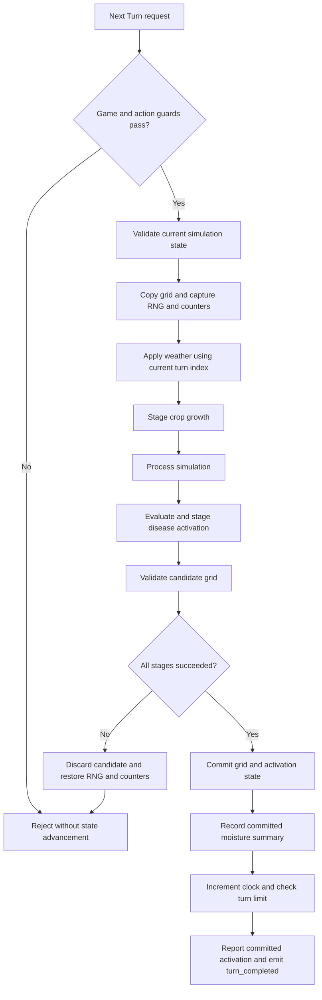

# Weather Cycle Design

Status: proposed verification and gap-fix design, prepared November 10, 2026.

Suggested location: `.kiro/specs/weather-cycle/design.md`.

## Design approach

Preserve the existing four-layer architecture and stateless WeatherManager. The feature already exists in code; implementation work begins with a coverage audit and changes only demonstrated gaps. No new manager, autoload, timer, weather enum, or production data resource is required.

The acceptance contract is defined in `requirements.md` and `features/weather_cycle.feature`. The current Gherkin file describes existing hydration behavior; supplemental boundary cases listed in the requirements must be added during implementation planning.

## Components and ownership

| Component / repository path | Responsibility |
|---|---|
| `src/logic/environment/weather_manager.gd` | Validate settings, derive weather from turn index, update staged soil, report committed diagnostics. |
| `src/simulation/models/soil_moisture_model.gd` | Pure bounded moisture calculation. |
| `src/logic/farming/farming_controller.gd` | Own authoritative grid; copy, stage, validate, commit or discard the complete turn. |
| `src/logic/turns/turn_controller.gd` | Guard requests, supply current index, advance clock, emit completion. |
| `src/data/state/field_grid_state.gd` and soil resources | Passive state, validation, detached copies. |
| `src/presentation/world/field_prototype_presenter.gd` | Route Next Turn input and refresh existing presentation. |
| `tests/logic/weather_soil_tools_test.gd` | Existing weather and scene integration regressions; preferred place to extend coverage. |

### Existing interfaces to preserve

- `WeatherManager.validate_configuration() -> PackedStringArray`
- `WeatherManager.apply_to_grid(staged_grid, turn_index) -> bool`
- `WeatherManager.report_committed_moisture(before, after, completed_turn) -> void`
- `FarmingController.advance_simulated_turn(...) -> bool`
- `TurnController.advance_turn() -> bool`
- `TurnController.turn_completed(turn_index)`

WeatherManager exposes `last_error` and `last_moisture_summary`. It does not currently expose a weather-sample object. Tests should verify effective weather through controlled moisture fixtures and independent expected calculations, rather than require a new public sampling API solely for testing.

## Turn transaction



The diagram summarizes the success path: an error at any staging step skips subsequent work and enters rollback. Initial validation failures return before staging. The weather summary is currently recorded after field commit inside FarmingController, before TurnController increments its clock; its label uses `turn_index + 1`. Preserve this order unless a separate atomicity issue is demonstrated. Never print a success summary while changes are only staged.

Pending farmer actions already block advancement. Existing game-state, reentrancy, and turn-limit behavior must remain intact. No per-cell presentation events are emitted while weather is staged.

## Configuration

| Setting | Default | Runtime constraint when enabled |
|---|---:|---|
| `enabled` | true | Boolean |
| `debug_moisture_updates` | true | Boolean |
| `base_temperature_celsius` | 25 | Finite, at least -273.15 |
| `rainfall_per_turn` | 0.02 | Finite, [0, 1] |
| `evaporation_per_turn` | 0.02 | Finite, [0, 1] |
| `ambient_humidity` | 0.5 | Finite, [0, 1] |
| `rainfall_moisture_scale` | 1 | Finite, nonnegative |
| `temperature_reference_celsius` | 25 | Finite, at least -273.15 |
| `temperature_evaporation_sensitivity` | 0.02 | Finite, nonnegative |
| `humidity_reference` | 0.5 | Finite, [0, 1] |
| `humidity_evaporation_sensitivity` | 1 | Finite, nonnegative |
| `minimum_evaporation_factor` | 0 | Finite, nonnegative |
| `maximum_evaporation_factor` | 3 | Finite, not below minimum |
| `fluctuations_enabled` | false | Boolean |
| `temperature_amplitude` | 0 | Finite, nonnegative |
| `rainfall_amplitude` | 0 | Finite, [0, 1] |
| `cycle_length_turns` | 8 | Integer greater than zero |
| `source_mode` | INSPECTOR | Only supported enabled mode |
| `climate_resource` | null | Unused future hook |
| `climate_csv_path` | empty | Unused future hook |

When fluctuations are enabled, `base_temperature_celsius - temperature_amplitude` must be at least -273.15. Editor slider limits may be narrower than runtime validation; do not silently introduce new runtime limits.

Disabled weather bypasses configuration validation, including unsupported sources, but still requires a valid staged grid and nonnegative index. Disabling weather does not freeze the shared clock.

## Calculations

For pre-commit index `t`, positive cycle length `L`, and `clamp(x, a, b)`:

```text
wave = sin(2 * pi * (t modulo L) / L) if fluctuations_enabled else 0
temperature = base_temperature_celsius + wave * temperature_amplitude
rainfall = clamp(rainfall_per_turn + wave * rainfall_amplitude, 0, 1)
temperature_factor = clamp(
    1 + (temperature - temperature_reference_celsius)
        * temperature_evaporation_sensitivity,
    minimum_evaporation_factor, maximum_evaporation_factor)
humidity_factor = clamp(
    1 + (humidity_reference - ambient_humidity)
        * humidity_evaporation_sensitivity,
    minimum_evaporation_factor, maximum_evaporation_factor)
evaporation = evaporation_per_turn * temperature_factor * humidity_factor
next_moisture = clamp(
    current_moisture + rainfall * rainfall_moisture_scale - evaporation,
    0, 1)
```

Temperature and humidity factors are capped independently. Evaporation need not be limited to one; final moisture is bounded. Validate finite intermediate factors and calculation results before assigning moisture. WeatherManager computes all tile updates before applying them to the staged grid, avoiding partial weather writes on a calculation failure.

### Numeric acceptance examples

With default settings, fluctuations enabled, length 4, temperature amplitude 5, rainfall amplitude 0.02, and each independent fixture starting at moisture 0.5:

| Pre-commit index | Temperature | Rainfall | Evaporation | Resulting moisture |
|---:|---:|---:|---:|---:|
| 0 | 25 | 0.02 | 0.020 | 0.500 |
| 1 | 30 | 0.04 | 0.022 | 0.518 |
| 2 | 25 | 0.02 | 0.020 | 0.500 |
| 3 | 20 | 0 | 0.018 | 0.482 |
| 4 | 25 | 0.02 | 0.020 | 0.500 |

These are independent cases, not cumulative moisture values. A separate sequential test must verify accumulated moisture across turns. With temperature 35, humidity 0.3, rainfall zero, and other defaults, evaporation is `0.02 * 1.2 * 1.2 = 0.0288` and moisture falls from 0.5 to 0.4712.

## State isolation and failure handling

Weather modifies only soil moisture. It must not overwrite `AbioticState`, which disease simulation already uses. Growth uses the newly staged moisture, while disease formulas remain unchanged.

On failure, preserve the authoritative grid, turn index, activation state, prior successful summary, and completion-event count. Restore RNG state and simulation cap counters captured before staging. Failure diagnostics may change. Retrying the same configuration and index must reproduce the weather contribution.

Runtime configuration edits are inputs to the next attempt, not transactions that immediately change the field. Existing Inspector defaults remain balanced and fluctuations remain opt-in; enabling a demonstration cycle does not change shipped defaults.

## Verification design

1. Audit the existing weather tests before adding assertions; reuse fixtures and avoid duplicating equivalent coverage.
2. Verify sine boundary phases, repetition, one-turn cycles, disabled fluctuations, rainfall bounds, response-factor caps, normalized soil bounds, and a cumulative multi-turn run.
3. Use controlled empty-soil fixtures to isolate moisture arithmetic. For growth ordering, choose crop conditions where old and updated moisture produce distinguishable expected growth outcomes.
4. Inject a simulation failure after weather and growth staging. Compare full snapshots, clock, RNG, counters, activation state, summary, and emitted completion count before and after. Retry and assert the expected phase outcome.
5. Test invalid numeric inputs, invalid grids and indices, unsupported modes, disabled validation bypass, re-enable behavior, and configuration changes.
6. Exercise the saved scene's actual Next Turn route and inspect existing soil UI refresh. Verify pending actions and unavailable game states reject advancement without consuming weather.
7. Map every Gherkin example to a named assertion. Use absolute tolerance 0.000001 for computed floating-point comparisons. Do not claim Gherkin execution merely because matching Godot tests pass.

## Delivery and compatibility

Place the specification under `.kiro/specs/weather-cycle/` and the feature under `features/`. Update acceptance references and weather documentation as needed. Use typed GDScript and existing ownership boundaries for any gap fixes. If saved scene wiring needs repair, use Godot Editor APIs and serialization; do not manually patch scene/resource text.

No new dependencies, persistent save schema, external services, or assets are required. Source inspection confirms existing behavior but is not a test run. Record the revision, commands, and results when implementation tasks are executed.
