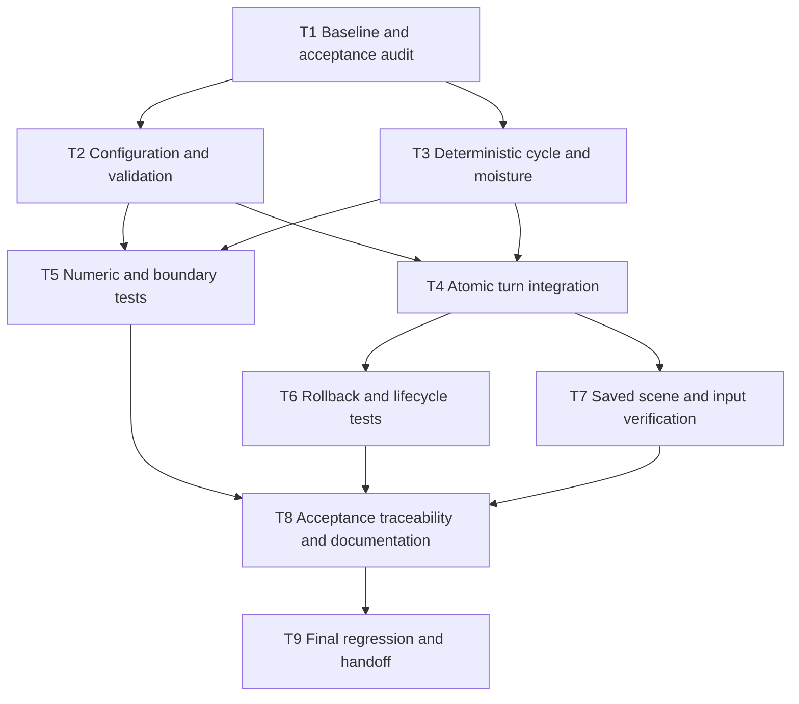

# Weather Cycle Tasks

Status: reviewed against `main` at `198fca1e7c3a63e7bdf43979a8f0ad59876a6340`. This is a source review; no Godot tests were run for this review. Tasks remain open until their completion evidence is satisfied.

Suggested location: `.kiro/specs/weather-cycle/tasks.md`.

The repository already contains weather implementation and regression tests. Each implementation task means inspect, reuse, verify, and repair only confirmed gaps. A task may complete without a production-code change if coverage demonstrates compliance.

## Repository review findings

| Finding | Evidence and effect on this plan |
|---|---|
| Weather implementation is already present | WeatherManager still has balanced defaults, deterministic fluctuations, validation, null-soil skipping, and committed summaries. T2–T4 are verification/gap-fix tasks, not new system construction. |
| Weather artifacts are not yet in the reviewed main tree | Neither `features/weather_cycle.feature` nor `.kiro/specs/weather-cycle/` is present. T1 publication and T8 steering-reference work remain open. |
| Existing weather tests cover part of the contract | Tests cover moisture clamps, settings changes, disabled weather, CSV rejection, NaN rainfall, factor caps, repetition at indices 1/5, growth ordering, selected rollback fields, and native balanced/wet/dry input. T5/T6 should extend these checks, not duplicate them. |
| Exact cycle and failure assertions remain incomplete | The weather test uses zero temperature amplitude for repetition and disables fluctuations for failure/retry. It does not establish the feature's nonzero-temperature phase examples or full RNG/activation rollback. Preserve these as explicit T5/T6 gaps. |
| Fences introduce another null-soil lifecycle | `_apply_fence()` sets grass, clears crop state, and removes soil. `_remove_fence()` leaves null soil until digging. Add weather/fence integration to T5/T7 under the existing all-soil/no-soil contract. |
| Test runner has expanded | `tools/run_tests.py` registers 29 tests and supports repeatable `--test` selections, including four fence tests and four menu tests. Use the current runner rather than historical counts. |
| Documentation is behind the runner | Weather documentation refers to 16 tests; the handoff refers to 21. Neither establishes the current 29-test result. T8 must reconcile counts and result provenance. |

No parent task is marked complete solely because corresponding production code or a checked checklist exists. The fence task document itself contains checked parent tasks with unchecked children; use implementation and run evidence rather than copying its completion status.

Review sources (pinned to the inspected revision): [weather tests](https://github.com/spatrickjs/test-game-project/blob/198fca1e7c3a63e7bdf43979a8f0ad59876a6340/tests/logic/weather_soil_tools_test.gd), [farming and fence transactions](https://github.com/spatrickjs/test-game-project/blob/198fca1e7c3a63e7bdf43979a8f0ad59876a6340/src/logic/farming/farming_controller.gd), [test runner](https://github.com/spatrickjs/test-game-project/blob/198fca1e7c3a63e7bdf43979a8f0ad59876a6340/tools/run_tests.py), [weather documentation](https://github.com/spatrickjs/test-game-project/blob/198fca1e7c3a63e7bdf43979a8f0ad59876a6340/docs/WEATHER_AND_SOIL_TOOLS.md).

## Dependency graph

An arrow means the destination requires the source to be complete. All incoming dependencies are required. Parallel branches indicate permissible work ordering, not a request to create agents.

| Task | Direct dependencies | Requirements | Completion evidence |
|---|---|---|---|
| T1 | None | R1–R8 | Revision and scenario coverage/gap map |
| T2 | T1 | R5, R6 | Validated configuration contract |
| T3 | T1 | R2, R3 | Verified formulas and isolated state updates |
| T4 | T2, T3 | R1, R4, R5, R7 | Verified transaction and diagnostics |
| T5 | T2, T3 | R2, R3, R5, R6, R8 | Passing numeric/boundary checks |
| T6 | T4 | R1, R4, R5, R7, R8 | Passing failure/retry and lifecycle checks |
| T7 | T4 | R1, R3, R4, R7, R8 | Saved scene and input results |
| T8 | T5, T6, T7 | R1–R8 | Complete mapping and updated docs |
| T9 | T8 | R8 | Final test record and limitation report |

## Checklist

- [ ] **T1 — Audit the current baseline and reconcile acceptance criteria**
  - Record repository branch, commit SHA, Godot version, and baseline test status.
  - Start from the reviewed SHA above, then record any newer revision before implementation. Read the current repository instructions before changing code.
  - Read WeatherManager, SoilMoistureModel, FarmingController turn staging, TurnController, the existing weather test, and test-runner registration.
  - Place the three spec documents under `.kiro/specs/weather-cycle/` and `weather_cycle.feature` under `features/` in the implementation checkout.
  - Map all 16 scenario declarations, including every Scenario Outline row, to existing assertions or explicit gaps.
  - Add supplemental Gherkin cases for guards/reset, sequential accumulation, re-enable phase, validation boundaries, and committed diagnostic behavior required by this specification.
  - Add fence/no-soil lifecycle examples: fencing removes soil, fence removal alone does not recreate it, and digging restores eligibility for later weather updates.
  - Document any conflict between code, feature, and requirements before changing behavior. Follow the repository's proposal/approval workflow for subsequent implementation; preparing these specification files does not itself approve game-code changes.
  - Done when: scope, touched files, missing coverage, and baseline failures are recorded.

- [ ] **T2 — Verify configuration and validation**
  - Depends on: T1.
  - Preserve exported settings, defaults, and Inspector-only source support.
  - Verify normalized values, finite numbers, nonnegative sensitivities/amplitudes, temperature floor, factor ordering, and positive cycle lengths.
  - Verify invalid grid/index rejection and disabled-weather configuration bypass.
  - Preserve actionable errors and reject non-finite calculation outcomes without partial writes.
  - Primary file: `src/logic/environment/weather_manager.gd`.
  - Done when: every validation rule in R5/R6 has an implementation location and planned or existing test.

- [ ] **T3 — Verify cycle and hydration calculations**
  - Depends on: T1.
  - Preserve zero-based phase selection, deterministic sine calculation, rainfall clamping, and independently capped evaporation factors.
  - Confirm temperature and rainfall amplitudes, disabled fluctuations, and length-one behavior.
  - Apply bounded moisture changes to every soil state and skip null soil.
  - Treat fenced grass and newly unfenced grass as null-soil cells; weather must not recreate their soil or remove fences.
  - Preserve other soil fields, crop state, and shared abiotic temperature/humidity during the weather stage.
  - Primary files: WeatherManager and `src/simulation/models/soil_moisture_model.gd`.
  - Done when: formulas match `design.md` and any discrepancy has a focused fix or documented resolution.

- [ ] **T4 — Verify atomic turn integration and committed diagnostics**
  - Depends on: T2, T3.
  - Verify weather precedes growth, simulation, activation, candidate validation, and commit.
  - Confirm weather uses the current clock without maintaining another phase counter.
  - Preserve request guards, pending-action rejection, new-session phase zero, and single clock advancement.
  - Ensure failures discard candidate data and restore RNG/counters without committing activation state or emitting completion.
  - Verify summaries are recorded only after field commit, use the completed-turn number, and distinguish disabled/balanced outcomes.
  - Verify runtime edits and disabling/re-enabling do not reset or freeze the shared clock.
  - Primary files: FarmingController, TurnController, WeatherManager.
  - Done when: the success path, rollback path, and diagnostic order match the design.

- [ ] **T5 — Extend numeric and boundary regression coverage**
  - Depends on: T2, T3.
  - Add missing tests to `tests/logic/weather_soil_tools_test.gd`, reusing existing fixtures.
  - Check the four cycle phases and repeated phases, disabled fluctuations, length one, and cumulative updates over multiple turns.
  - Check exact expected examples from the feature: 0.518, 0.482, and warm/dry 0.4712; use tolerance 0.000001.
  - Check rainfall underflow/overflow, moisture saturation, response-factor caps, soil/no-soil targets, and preservation of unrelated fields.
  - Check invalid cycle lengths, NaN/infinity, normalized range violations, negative sensitivities, reversed caps, absolute-zero violations, invalid grid/index, and both unsupported sources.
  - Check weather-disabled validation bypass and no moisture contribution.
  - Done when: targeted numeric/boundary tests pass with no engine warnings/errors attributable to the change.

- [ ] **T6 — Extend rollback, ordering, and lifecycle tests**
  - Depends on: T4.
  - Prove growth consumes updated moisture with a fixture that distinguishes old and new moisture outcomes.
  - Inject a failure after weather and growth; compare full field snapshots and related transaction state.
  - Verify unchanged clock, activation state, RNG, cap counters, committed summary, and completion-event count on failure.
  - Resolve the failure and retry; verify the same phase and exactly one successful completion.
  - Check idle frames, runtime setting edits, new-session phase zero, and disabled/re-enabled phase selection.
  - Check debug output enabled/disabled, zero-soil summaries, balanced summaries, and failed-attempt silence.
  - Extend the existing `RejectedTurn` fixture to actually alter RNG/cap counters before failure; otherwise equality checks would not prove restoration. Use an activation-enabled fixture and nonzero weather amplitudes for rollback/retry coverage.
  - Done when: ordering and transaction invariants have passing regression assertions.

- [ ] **T7 — Verify the saved scene and player input route**
  - Depends on: T4.
  - Confirm saved WeatherManager references and the presenter's Next Turn connection.
  - Exercise actual button input for balanced, wetting, and drying configurations; verify displayed soil values and committed turn numbering.
  - Reuse `GameplayFixture` and `QueueDriver` as the existing weather test does. Complete queued actions before requesting successful turns, and test pending-action rejection separately.
  - Fence a soil tile through the action queue, advance a turn, and verify null soil and fence state remain intact while neighboring soil updates. Remove the fence, verify it remains soil-free, then dig and verify weather resumes on the restored soil on the next turn.
  - Confirm queued farmer actions, unavailable gameplay state, and applicable turn-limit guards prevent weather advancement.
  - Confirm field tools and camera interactions do not independently advance weather.
  - Repair scene wiring only if a gap is demonstrated, using Godot Editor APIs.
  - Record desktop results and Android touch verification separately; untested device behavior remains an explicit gap.
  - Done when: scene integration passes and any device-specific limitation is documented.

- [ ] **T8 — Complete traceability and usage documentation**
  - Depends on: T5, T6, T7.
  - Map every final Gherkin scenario/example to the exact test file and assertion or test function.
  - Update `.kiro/steering/game-acceptance-criteria.md` to reference `features/weather_cycle.feature`.
  - Update `docs/WEATHER_AND_SOIL_TOOLS.md` with a reproducible opt-in cycle demo and the difference between balanced moisture and skipped weather.
  - Reconcile outdated test counts in weather documentation and the handoff with the runner. Date and label historical results; only publish current pass/fail claims after T9 supplies execution evidence.
  - Record that Godot tests verify the Gherkin behavior; do not imply direct `.feature` execution without a runner and step bindings.
  - Keep Inspector defaults unchanged and external climate sources marked unsupported.
  - Done when: no acceptance case is silently omitted and the docs reflect verified behavior.

- [ ] **T9 — Run final regression checks and prepare handoff**
  - Depends on: T8.
  - Run targeted tests using the repository's supported invocation discovered in T1.
  - Supported weather command: `python tools/run_tests.py --godot "<path-to-Godot-executable>" --test tests/logic/weather_soil_tools_test.gd`.
  - Run integration selections using repeated `--test` arguments for `tests/logic/queued_field_actions_test.gd`, `tests/logic/fence_treatment_test.gd`, `tests/logic/fence_treatment_property_test.gd`, `tests/simulation/fence_containment_test.gd`, and `tests/presentation/fence_presentation_test.gd` where affected.
  - Run the registered suite with `python tools/run_tests.py --godot "<path-to-Godot-executable>"`.
  - Register any new standalone test with the runner; no registration change is needed when extending an existing registered test.
  - Record commit SHA, engine version, commands, PASS markers, exit status, and relevant logs.
  - The runner requires exit code zero, an `_PASS` marker, and no `ERROR:`, `WARNING:`, or `FAIL:` diagnostics. A marker alone does not establish success.
  - Compare failures against the T1 baseline; distinguish new regressions, existing failures, and unverified device checks.
  - Finalize the result sections drafted in T8 using this run's evidence; this is T9's handoff output and does not add a reverse dependency from T8 to T9.
  - Review the diff for generated `.godot/` files, unrelated asset changes, and accidental scene/default changes.
  - Done when: weather acceptance checks pass, new regressions are resolved, and any unrelated blockers are explicitly reported. Do not call the full suite green if any registered test still fails.

## Suggested execution order

T1 → (T2 and T3) → (T4 and T5) → (T6 and T7) → T8 → T9.

T4 and T5 may proceed concurrently once T2/T3 finish. T8 waits for T5/T6/T7. Within a shared file, coordinate edits sequentially. If a fix changes behavior after a dependent test task completes, rerun the affected tests before closing T9.
